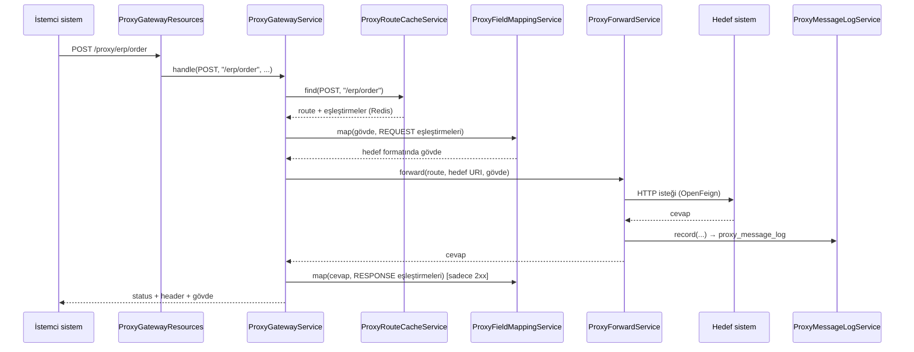
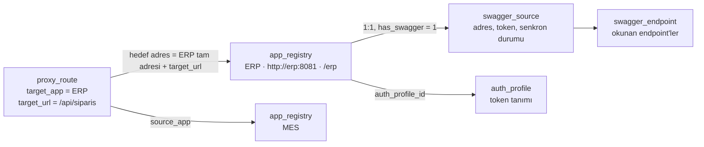
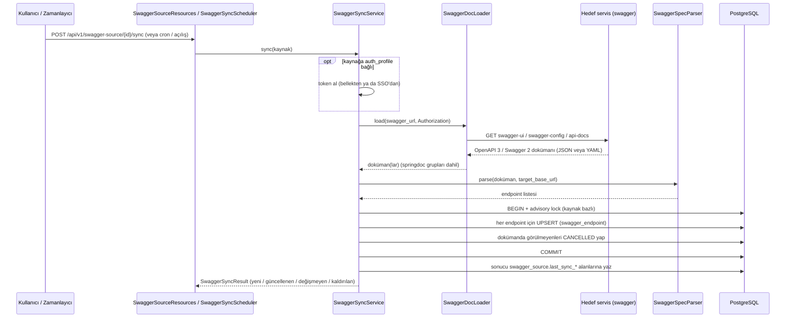
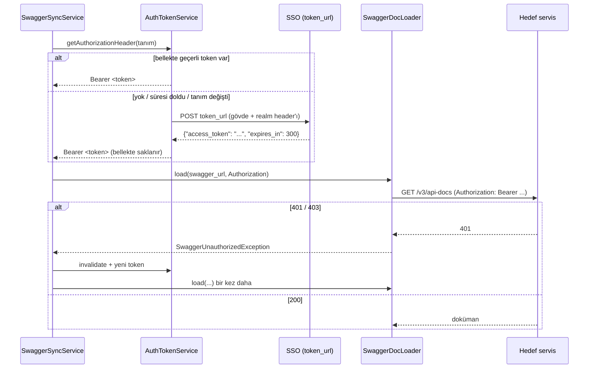

# Message Proxy (TatMetal)

Gelen REST isteklerini, veritabanında tanımlı kurallara göre başka bir sisteme REST ile ileten proxy servis.

- Gelen isteğin **path + HTTP metodu** hangi hedefe gidileceğini (route) belirler.
- Gelen gövdedeki alan isimleri hedef sistemin beklediği isimlere **eşleştirilir** (mapping). Gerekirse hedefin cevabı da geri dönerken eşleştirilir.
- Route ve eşleştirme tanımları PostgreSQL'de tutulur. Uygulama açılışta bunları **Redis**'e yükler, isteklerde sadece Redis'ten okur.
- Hedefin cevabı (status, header, gövde) isteği gönderen sisteme aynen döner.
- Her iletim `proxy_message_log` tablosuna kaydedilir.
- Entegre olunan uygulamalar `app_registry`'de tanımlanır (ad, amaç, adres, base path, swagger). Route'lar ve swagger kaynakları uygulamaya bağlanır; "hangi uygulama kimlerle entegre" bilgisi route'lardan çıkarılır (bkz. [Uygulama kaydı](#uygulama-kaydı-app_registry)).
- Ayrıca entegre olunan servislerin **swagger dokümanları okunup** tüm endpoint'leri `swagger_endpoint` tablosuna yazılır ve güncel tutulur; token korumalı dokümanlar için token `auth_profile` tanımına göre otomatik alınır (bkz. [Swagger'dan endpoint senkronizasyonu](#swaggerdan-endpoint-senkronizasyonu)).

---

## İçindekiler

1. [Teknoloji](#teknoloji)
2. [Hızlı başlangıç](#hızlı-başlangıç)
3. [Çalışma mantığı](#çalışma-mantığı)
4. [Paket yapısı](#paket-yapısı)
5. [Sınıf referansı](#sınıf-referansı)
6. [Veritabanı tabloları](#veritabanı-tabloları)
7. [Redis önbellek](#redis-önbellek)
8. [Route eşleşme kuralları](#route-eşleşme-kuralları)
9. [Alan eşleştirme (mapping)](#alan-eşleştirme-mapping)
10. [Uygulama kaydı (app_registry)](#uygulama-kaydı-app_registry)
11. [Swagger'dan endpoint senkronizasyonu](#swaggerdan-endpoint-senkronizasyonu)
12. [REST API referansı](#rest-api-referansı)
13. [Hata cevapları](#hata-cevapları)
14. [Loglama](#loglama)
15. [Konfigürasyon](#konfigürasyon)
16. [Yeni bir entegrasyon tanımlama (adım adım)](#yeni-bir-entegrasyon-tanımlama-adım-adım)
17. [Geliştirici notları](#geliştirici-notları)
18. [Sorun giderme](#sorun-giderme)

---

## Teknoloji

| Bileşen | Sürüm / Not |
|---|---|
| Java | 17 |
| Spring Boot | 2.6.4 |
| Spring Cloud | 2021.0.1 (OpenFeign + Apache HttpClient 5) |
| Veritabanı | PostgreSQL 13+ (JDBC, kurum içi `mini_jpa` 0.0.341) |
| Önbellek | Redis (`spring-boot-starter-data-redis` / Lettuce, sürüm Boot BOM'undan; `StringRedisTemplate` ile kullanılır) |
| Güvenlik | Kurum içi `exss-service` 0.0.67 |
| Lombok | Kullanılmaz |

Proje parametreleri (standart dokümanına göre):

| Parametre | Değer |
|---|---|
| Kök paket | `tr.com.tatmetal.proxy` |
| Şema | `message_proxy` |
| JdbcTemplate qualifier | `exdbJdbcTemplate` |

---

## Hızlı başlangıç

**Gerekenler:** PostgreSQL 13+, Redis, Maven, kurum içi Maven reposuna erişim (`mini_jpa`, `exss-service`).

```bash
# 1) PostgreSQL ve Redis ayarlarını application.properties içinde kontrol edin
# 2) Uygulamayı başlatın
mvn spring-boot:run
```

Açılışta sırasıyla şunlar olur:

1. `schema.sql` çalışır; şema, tablolar ve yeni kolonlar yoksa oluşturulur.
2. `ProxyRouteCacheService` aktif route ve eşleştirmeleri veritabanından okuyup Redis'e yazar.
3. Uygulama `/proxy/**` altındaki istekleri karşılamaya başlar.

Hızlı deneme için [Yeni bir entegrasyon tanımlama](#yeni-bir-entegrasyon-tanımlama-adım-adım) bölümüne bakın.

---

## Çalışma mantığı



Adım adım:

| # | Adım | Sorumlu sınıf | Hata durumunda |
|---|---|---|---|
| 1 | `/proxy` prefix'i çıkarılır, kalan path bulunur | `ProxyGatewayResources` | — |
| 2 | Path + metot ile route Redis'ten bulunur | `ProxyRouteCacheService` | 404 `ROUTE_NOT_FOUND` |
| 3 | Hedef URL hazırlanır (`{id}` değişkenleri + query string). Göreli `target_url` Redis yüklemesinde hedef uygulamanın adresiyle çözülmüştür | `ProxyGatewayService` | 500 `INVALID_TARGET_URL` |
| 4 | REQUEST eşleştirmeleri gövdeye uygulanır | `ProxyFieldMappingService` | 400 `REQUEST_MAPPING_ERROR` |
| 5 | İstek hedefe iletilir | `ProxyForwardService` + `ProxyForwardClient` | 502 / 504 |
| 6 | İletim loglanır | `ProxyMessageLogService` | Log hatası iletimi bozmaz |
| 7 | 2xx JSON cevaba RESPONSE eşleştirmeleri uygulanır | `ProxyFieldMappingService` | 502 `RESPONSE_MAPPING_ERROR` |
| 8 | Cevap çağırana döner | `ProxyGatewayService` | — |

Hedefin 4xx/5xx cevapları hata sayılıp değiştirilmez; status, header ve gövde aynen döner.

---

## Paket yapısı

```
tr.com.tatmetal.proxy
├── MessageProxyApplication          Uygulama giriş noktası
├── api.v1.resources                 REST API katmanı        (*Resources)
├── services                         Service katmanı         (*Service)
├── entity                           Entity katmanı          (*Entity, BaseEntity'den extend)
├── dao                              Dao katmanı             (*DaoImpl)
│   └── sql                          SQL sabitleri           (*Sql)
├── enums                            IEnumNumber enum'ları   (standart dışı ek paket)
├── model                            Redis'te tutulan tanım nesneleri (standart dışı ek paket)
├── exception                        Uygulama exception'ları (standart dışı ek paket)
├── client                           OpenFeign client'ları   (standart dışı ek paket)
├── swagger                          Swagger dokümanı okuma/parse (standart dışı ek paket)
├── auth                             Token şifreleme ve sonuç sınıfları (standart dışı ek paket)
├── app                              Uygulama genel bakış (entegrasyon haritası) cevap sınıfları (standart dışı ek paket)
└── config                           Spring konfigürasyonları (standart dışı ek paket)
```

Tablo bazlı sınıf isimlendirmesi (ör. `proxy_field_map` tablosu):

| Katman | Sınıf |
|---|---|
| Entity | `ProxyFieldMapEntity` |
| Sql | `ProxyFieldMapSql` |
| Dao | `ProxyFieldMapDaoImpl` |
| Service | `ProxyFieldMapService` |
| Rest Api | `ProxyFieldMapResources` |

---

## Sınıf referansı

### Uygulama

#### `MessageProxyApplication`
Spring Boot giriş noktası.
- `tr.com.tatmetal.proxy` ile birlikte `tr.com.zenergy.mini_jpa` paketini de tarar. Böylece `@ExtendsBaseEntity` aspect'i gibi `mini_jpa` bileşenleri bean olarak yüklenir.
- `@EnableFeignClients` ile `client` paketindeki Feign client'larını etkinleştirir.
- `@EnableScheduling` ile zamanlanmış görevleri açar (`SwaggerSyncScheduler`).

---

### `api.v1.resources` — REST API katmanı

#### `ProxyGatewayResources`
Proxy'nin **giriş kapısı**. `${proxy.gateway.prefix}/**` (varsayılan `/proxy/**`) altındaki GET, POST, PUT, PATCH ve DELETE isteklerini karşılar.
- Prefix'i path'ten çıkarır. Örnek: `/proxy/erp/order` → `/erp/order`.
- Header'ları, query string'i, ham gövdeyi (`byte[]`) ve istemci IP'sini toplar. IP için önce `X-Forwarded-For`, yoksa `remoteAddr` kullanılır.
- İşin geri kalanını `ProxyGatewayService.handle(...)`'a devreder.

#### `ProxyRouteResources`
`/api/v1/proxy-route`: route tanımlarının CRUD işlemleri ve Redis önbellek yönetimi. Doğrulama hataları (ör. göreli `targetUrl` için hedef uygulama yok) 400 `VALIDATION_ERROR` döner. Her kayıt değişikliğinden sonra Redis otomatik yenilenir. Uç noktalar için [REST API referansı](#rest-api-referansı)'na bakın.

#### `ProxyFieldMapResources`
`/api/v1/proxy-field-map`: alan eşleştirme tanımlarının CRUD işlemleri.
- Hatalı alan yolu (örneğin `[]` sayısı tutmuyor) `ProxyMappingException` olarak yakalanır ve **400 `VALIDATION_ERROR`** döner.
- Eksik `proxyRouteId` `IllegalArgumentException` olarak yakalanır, yine 400 döner.

#### `ProxyMessageLogResources`
`/api/v1/proxy-message-log`: iletim loglarını **salt okunur** sorgular. Kayıtları `ProxyForwardService` ve `ProxyGatewayService` yazar.

#### `SwaggerSourceResources`
`/api/v1/swagger-source`: swagger kaynaklarının CRUD işlemleri ve elle senkronizasyon (`/{id}/sync`, `/sync`).
- `IllegalArgumentException` (eksik `sourceCode`, geçersiz `swaggerUrl`) yakalanır ve **400** `{"message": "..."}` döner.
- `/{id}/sync` kaynak yoksa veya CANCELLED ise 404 döner.

#### `AppRegistryResources`
`/api/v1/app-registry`: uygulamaların CRUD işlemleri, `/{id}/sync`, `/{id}/overview`, `/overview`. `IllegalArgumentException` 400 `{"message": "..."}` döner.

#### `AuthProfileResources`
`/api/v1/auth-profile`: token tanımlarının CRUD işlemleri ve `/{id}/test`. `password` / `clientSecret` cevaplarda hiç dönmez; `IllegalArgumentException` 400 `{"message": "..."}` olarak döner.

#### `SwaggerEndpointResources`
`/api/v1/swagger-endpoint`: okunan endpoint'leri sorgular. Ekleme ve silme yoktur; `PUT` sadece `status`'u (ör. PASSIVE) değiştirmek için kullanılır.

---

### `services` — Service katmanı

#### `ProxyGatewayService`
Proxy akışının **orkestratörü**. `handle(method, path, queryString, clientIp, headers, body)` şunları yapar:
1. `ProxyRouteCacheService.find` ile route'u bulur. Yoksa 404, Redis/DB okunamazsa 503 döner.
2. `X-Correlation-Id` header'ı yoksa üretir. Bu değer hedefe de, cevapta çağırana da gönderilir.
3. `target_url` içindeki `{değişken}`'leri gelen path'ten doldurur (URL-encode ederek) ve gelen query string'i hedefe ekler.
4. REQUEST eşleştirmelerini uygular. Hata olursa 400 döner ve `MAPPING_ERROR` logu yazar; istek hedefe **gönderilmez**.
5. `ProxyForwardService.forward(...)`'u çağırır. Bağlantı hatasında 502, zaman aşımında 504 döner.
6. Cevap 2xx ise ve RESPONSE eşleştirmesi tanımlıysa cevabı dönüştürür. Hata olursa 502 döner.
7. Cevabı döndürür. Gövde değişmiş olabileceği için `Content-Length` ve hop-by-hop header'lar taşınmaz.

Eşleştirme sadece JSON gövdelere uygulanır: Content-Type `json` içeriyorsa ya da Content-Type yokken gövde `{` veya `[` ile başlıyorsa. Diğer içerikler (XML, form, binary) dokunulmadan iletilir.

#### `ProxyRouteCacheService`
Route + eşleştirme tanımlarının **Redis önbelleğini** yönetir.
- **`loadOnStartup()`**: `ApplicationReadyEvent` ile, yani `schema.sql` çalıştıktan sonra tetiklenir ve `reload()` çağırır. Redis veya DB o an erişilemezse uygulama yine açılır, hata loglanır; tanımlar ilk istekte tekrar yüklenmeye çalışılır.
- **`reload()`**: aktif route'ları ve eşleştirmeleri DB'den okur, `ProxyRouteDefinition` nesnelerine çevirip JSON olarak Redis'e yazar.
  - Veri önce geçici bir anahtara yazılır, sonra `RENAME` ile asıl anahtarın yerine geçer. Böylece okuyan istekler yarım veri görmez.
  - Aynı path + metot için birden fazla aktif route varsa ilki kullanılır ve uyarı loglanır.
- **`find(method, path)`**: route'u Redis'ten bulur. Sıralama için [Route eşleşme kuralları](#route-eşleşme-kuralları)'na bakın. Sonuç `ProxyRouteMatch` olarak döner: route ve path değişkenleri.
- **`ensureLoaded()`**: Redis'te `{prefix}:loaded-at` anahtarı yoksa (Redis yeniden başladı ya da temizlendi) tanımları DB'den otomatik yeniden yükler.
- **`getAll()`**: Redis'teki tüm tanımları döner. İzleme amaçlı kullanılır.
- **`resolveTargetUrl(targetUrl, hedefUygulama)`** (static): mutlak adresi olduğu gibi, göreli adresi uygulamanın tam adresiyle birleştirerek döner; çözülemiyorsa `null`. `reload()` göreli adresleri bununla çözer, çözülemeyen route'u yüklemez.
- **`normalizePath(path)`** (static): path'in başına `/` ekler, sonundaki `/`'ı kaldırır. Kayıt sırasında da kullanılır, böylece `erp/order/` ve `/erp/order` aynı route'a gider.

#### `ProxyFieldMappingService`
JSON **alan eşleştirme motoru**. Jackson `JsonNode` üzerinde çalışır.
- **`map(source, fieldMaps, passUnmappedFields)`**: kaynağı eşleştirme listesine göre dönüştürür.
  - Gövde en üstte bir diziyse (`[{...},{...}]`) her elemana ayrı uygulanır.
  - Tüm değerler önce değiştirilmemiş kaynaktan okunur, sonra yazılır. Bu sayede `a→b`, `b→a` gibi takaslar doğru çalışır.
  - `passUnmappedFields = true`: kaynak kopyalanır; eşleştirilen alanlar eski yerinden silinir, yeni yerine yazılır. Silme sonrası boş kalan ara nesneler de temizlenir.
  - `passUnmappedFields = false`: hedef boş başlar, sadece eşleştirilen alanlar yazılır.
  - İç içe hedef yolundaki ara nesneler yoksa oluşturulur.
- **`validate(sourceField, targetField)`** (static): alan yolu söz dizimini kontrol eder. Hem kayıt sırasında (`ProxyFieldMapService`) hem çalışma anında kullanılır.

Söz dizimi için [Alan eşleştirme](#alan-eşleştirme-mapping) bölümüne bakın.

#### `ProxyForwardService`
Eşleştirmesi yapılmış isteği **hedefe iletir** ve iletimi loglar. Tablodan bağımsızdır.
- **`forward(route, target, incomingMethod, requestPath, clientIp, headers, sourceBody, body)`**:
  - Hedef metodu belirler. Route'ta `PASS_THROUGH` ise gelen metot kullanılır.
  - Hop-by-hop header'ları (`Host`, `Content-Length`, `Connection`, ...) hedefe iletmez.
  - Route bazlı connect/read timeout'ları `Request.Options` ile çağrı anında uygular.
  - Hedef 4xx/5xx dönerse `FeignException`'ı exception olarak bırakmaz, `ResponseEntity`'e çevirir. Böylece cevap çağırana aynen döner.
  - Bağlantı hatası veya timeout'ta (`status <= 0`) log yazar ve exception'ı fırlatır. Gateway bunu 502 ya da 504'e çevirir.
  - Retry yoktur; idempotent olmayan çağrılar (POST vb.) çift gitmez.
- `CORRELATION_ID_HEADER = "X-Correlation-Id"` sabiti diğer sınıflarca da kullanılır.

#### `ProxyMessageLogService`
`proxy_message_log` tablosuna **iletim kaydı** yazar.
- **`record(...)`**: normal iletim kaydı. `result_type` HTTP status'tan hesaplanır.
- **`recordMappingError(...)`**: eşleştirme hatası kaydı (`result_type = MAPPING_ERROR`).
- `Authorization`, `Proxy-Authorization`, `Cookie`, `Set-Cookie` ve `X-Api-Key` header değerleri `******` olarak maskelenir.
- Gövdeler sadece `proxy_route.log_body = 1` ise yazılır ve `proxy.log.max-body-length` karakterde kesilir.
- Log yazımındaki hata **asla iletimi bozmaz**; sadece uygulama loguna düşer.
- Standart `save`, `getOne` ve `getByCondition` metotları da bulunur.

#### `ProxyRouteService`
`proxy_route` için CRUD.
- Kayıt öncesi `source_path`'i normalize eder.
- `targetAppRegistryId` / `sourceAppRegistryId` verildiyse uygulamanın var olduğunu kontrol eder; göreli `targetUrl` için `targetAppRegistryId` zorunludur.
- Her değişiklikten sonra `ProxyRouteCacheService.reload()` çağırır. Redis hatası kaydı geri almaz, sadece loglanır.

#### `ProxyFieldMapService`
`proxy_field_map` için CRUD.
- Kayıt öncesi `proxyRouteId` zorunluluğunu ve alan yolu söz dizimini doğrular, alan yollarındaki boşlukları kırpar.
- Her değişiklikten sonra Redis'i yeniler.

#### `SwaggerSyncService`
Swagger senkronizasyonunun **orkestratörü**. Tablodan bağımsızdır.
- **`sync(source)`**: dokümanı `SwaggerDocLoader` ile okur, `SwaggerSpecParser` ile endpoint'lere çevirir, tek transaction'da upsert + CANCELLED işlemini yapar, sonucu `swagger_source`'a yazar ve `SwaggerSyncResult` döner. Exception fırlatmaz; her hata sonuca `ERROR` olarak yazılır.
- **`sync(id)`**: kaynağı `id` ile bulur (CANCELLED hariç). Yoksa `null`.
- **`syncAllAuto()`**: `status = 3` ve `auto_sync = 1` olan kaynakları sırayla senkronize eder.
- Transaction `exDb` üzerinde `TransactionTemplate` ile açılır. HTTP okuma transaction dışındadır.
- Kilit alınamazsa (başka senkronizasyon sürüyor) `skipped = true` döner ve `swagger_source`'a yazmaz.
- Yazan kullanıcı olarak `user_who_recorded` / `user_who_last_updated` alanlarına `swagger-sync` yazılır.
- Kaynağa `auth_profile_id` bağlıysa dokümanları `Authorization` header'ı ile okur; `SwaggerUnauthorizedException` gelirse token'ı yenileyip bir kez daha dener.

#### `AuthTokenService`
Token alır ve `Authorization` değerini üretir. Tablodan bağımsızdır.
- **`getAuthorizationHeader(tanım)`**: bellekte geçerli token varsa onu, yoksa `AuthTokenClient` ile yenisini alır (`Bearer <token>`). Aynı tanım için eşzamanlı istekler tek token isteğine düşer.
- **`invalidate(id)`**: bellekteki token'ı siler.
- **`test(tanım)`**: bellek kullanmadan token almayı dener, `AuthTokenTestResult` döner.
- Gövdeyi tanımın alanlarından kurar, `custom_headers_json`'u header olarak ekler, `token_field` / `expires_field` yollarını okur. Hata durumunda `AuthTokenException` fırlatır; mesajda gizli değer bulunmaz.

#### `AuthProfileService`
`auth_profile` için CRUD.
- Doğrulama: `profileCode`, `tokenUrl` (`http(s)://`) zorunlu; `tokenMethod` POST/PUT; `customHeadersJson` / `extraBodyJson` JSON nesnesi olmalı. Boş alanlara tablo varsayılanlarını yazar.
- `password` / `clientSecret`: gelen değer şifrelenir; güncellemede boş gelirse eski değer korunur, `-` gelirse silinir. Anahtar yoksa şifre içeren kayıt reddedilir.
- `update` / `delete` sonrası bellekteki token silinir.

#### `AppRegistryService`
`app_registry` CRUD ve uygulamaya bağlı kayıtların yönetimi.
- Doğrulama ve normalizasyon: `appCode`, `appName`, `baseUrl` (`http(s)://`) zorunlu; `base_path` / `swagger_path` biçimlenir; `authProfileId` kontrol edilir; swagger kod çakışması kayıttan **önce** kontrol edilir.
- **`save` / `update`**: swagger kaynağını oluşturur / günceller / PASSIVE yapar (bkz. [Swagger kaynağının yönetimi](#swagger-kaynağının-yönetimi)); `update` sonrası Redis'i yeniler.
- **`delete`**: bağlı route yoksa `status = CANCELLED` yapar (fiziksel silme yok), swagger kaynağını PASSIVE yapar, Redis'i yeniler.
- **`sync(id)`**: uygulamanın swagger'ını hemen senkronize eder.
- **`overview(id)` / `overviewAll()`**: uygulama + swagger durumu + `outgoing` / `incoming` entegrasyonlar.

#### `SwaggerSyncScheduler`
Otomatik senkronizasyon. `swagger.sync.enabled=false` ise bean hiç oluşmaz.
- **`onStartup()`**: `ApplicationReadyEvent` ile (yani `schema.sql` çalıştıktan sonra) `swagger.sync.on-startup=true` ise `syncAllAuto()` çağırır.
- **`onSchedule()`**: `swagger.sync.cron` zamanlamasıyla `syncAllAuto()` çağırır.
- Hata uygulamayı durdurmaz, sadece loglanır.

#### `SwaggerSourceService`
`swagger_source` için CRUD.
- Kayıt öncesi `sourceCode` ve `swaggerUrl` zorunluluğunu, `swaggerUrl`'in `http(s)://` ile başladığını, `authProfileId` verildiyse tanımın var olduğunu kontrol eder; boş alanlara tablo varsayılanlarını (`-`, `autoSync = 1`, `lastSyncResult = NEVER`) yazar.
- **`save`**: kayıttan sonra `autoSync` 0 değilse hemen senkronize eder ve kaydı son hâliyle (`lastSync*` dolu) döner. Okuma hatası kaydı engellemez.
- `saveAll` ve `update` senkronizasyon başlatmaz.
- Uygulamaya bağlı kaynakta kod / adres / token alanlarının değiştirilmesini ve API'den `appRegistryId` verilmesini reddeder. `saveForApp` / `updateForApp` bu kuralı uygulamayan, sadece `AppRegistryService`'in kullandığı metotlardır.

#### `SwaggerEndpointService`
`swagger_endpoint` için okuma (`getOne`, `getByCondition`) ve `update`. Ekleme/silme bilerek yoktur; kayıtları `SwaggerSyncService` yönetir.

---

### `client` — OpenFeign

#### `ProxyForwardClient`
Dinamik hedeflere istek atan **genel Feign client**.
- Her metotta bir `URI` parametresi vardır. Bu parametre client'ın varsayılan url'ini (`proxy.forward.default-url`) çağrı bazında ezer, böylece tek client ile her hedefe gidilir.
- `Request.Options` parametresi timeout'u çağrı bazında belirler.
- Gövde `byte[]` olarak taşınır; içerik dönüştürülmez.
- Metotlar: `get`, `post`, `put`, `patch`, `delete`. PATCH desteği Apache HttpClient 5 (`feign-hc5`) ile gelir.

#### `SwaggerDocClient`
Swagger dokümanlarını okumak için genel Feign client (`get(URI, Request.Options, headers)`). `ProxyForwardClient` gibi hedef adresi `URI` parametresiyle çağrı bazında alır. Timeout'lar `swagger.sync.connect-timeout-ms` / `read-timeout-ms` ile belirlenir. `ProxyFeignConfig`'i kullanır (retry yok).

#### `AuthTokenClient`
Token isteği için genel Feign client (`post` / `put(URI, Request.Options, headers, byte[] body)`). Hedef adres ve timeout'lar tanımdan çağrı bazında gelir. `ProxyFeignConfig`'i kullanır (retry yok, log seviyesi `BASIC`: sadece metot, adres ve status loglanır; gövde ve header'lar loglanmaz).

Sabit adresli başka bir sisteme çağrı gerekirse bu paketa ayrı bir `@FeignClient(name = "...", url = "${...}")` eklenmelidir.

---

### `config` — Konfigürasyon

#### `JdbcConfig`
Veri kaynaklarını ve `mini_jpa` template'lerini tanımlar.

| Bean | Açıklama |
|---|---|
| `exDb` (`@Primary`) | `datasource.exdb.*` ayarlarından oluşan ana DataSource. `schema.sql` bunun üzerinde çalışır. |
| `exdbJdbcTemplate` (`@Primary`) | Dao'ların `@Qualifier("exdbJdbcTemplate")` ile kullandığı `ZenergyNamedJdbcTemplate` |
| `pgDb` | `datasource.pgdb.*` ayarlarından ikinci DataSource |
| `pgJdbcTemplate` | İkinci DataSource için template |

> İkinci DataSource **`@Primary` olmamalıdır.** İki `@Primary` DataSource olursa Spring `schema.sql`'i çalıştırmaz.

#### `ProxyFeignConfig`
Sadece `ProxyForwardClient`'a özel Feign ayarları: Retry kapalı (`Retryer.NEVER_RETRY`) ve log seviyesi `BASIC`.
Bilerek `@Configuration` **değildir**; aksi halde ayarlar tüm Feign client'larına uygulanırdı.

---

### `entity` — Entity katmanı

Tüm entity'ler `mini_jpa` `BaseEntity`'den extend eder. Standart alanlar (`id`, `id_serial`, `etag`, `status`, `date_of_recorded`, ...) oradan gelir.

| Sınıf | Tablo | Açıklama |
|---|---|---|
| `ProxyRouteEntity` | `proxy_route` | Gelen path/metot → hedef tanımı |
| `ProxyFieldMapEntity` | `proxy_field_map` | Route'a bağlı kaynak alan → hedef alan eşleştirmesi |
| `ProxyMessageLogEntity` | `proxy_message_log` | İletim kaydı. `toString()` gövde ve header'ları bilerek yazmaz. |
| `SwaggerSourceEntity` | `swagger_source` | Swagger adresi okunacak servis ve son senkronizasyon sonucu |
| `SwaggerEndpointEntity` | `swagger_endpoint` | Swagger'dan okunan endpoint. `toString()` JSON kolonlarını yazmaz. |
| `AppRegistryEntity` | `app_registry` | Entegre olunan uygulama. `fullBaseUrl` ve `swaggerUrl` hesaplanan, salt okunur JSON alanlarıdır. |
| `AuthProfileEntity` | `auth_profile` | Token alma tanımı. `password` / `clientSecret` JSON'da sadece yazılabilir (cevapta yok), `passwordSet` / `clientSecretSet` okunabilir. `toString()` gizli alanları ve `extraBodyJson`'u yazmaz. |

Kolon detayları için [Veritabanı tabloları](#veritabanı-tabloları) bölümüne bakın.

---

### `dao` ve `dao.sql` — Veri erişim katmanı

Her Dao `@Repository`'dir ve `exdbJdbcTemplate` kullanır. Standart metotlar:

| Metot | Açıklama |
|---|---|
| `save`, `saveAll`, `update` | `@ExtendsBaseEntity` ile standart alanlar otomatik doldurulur |
| `delete` | `mini_jpa` delete: kaydı **fiziksel olarak siler** (`DELETE FROM ... WHERE id AND etag`). Standarttaki iptal için `update` ile `status = 1` kullanın |
| `getOne(id, etag)` | Tek kayıt |
| `getByCondition(params)` | `ParamsToCondition` ile dinamik WHERE. Örnek: `{"routeCode": "ERP_ORDER"}` |

Ek metotlar:

| Sınıf | Metot | SQL sabiti | Açıklama |
|---|---|---|---|
| `ProxyRouteDaoImpl` | `getActiveList()` | `ProxyRouteSql.PROXY_ROUTE_GET_ACTIVE_SQL` | `status = 3` ve `source_path <> '-'` olan route'lar |
| `ProxyFieldMapDaoImpl` | `getActiveList()` | `ProxyFieldMapSql.PROXY_FIELD_MAP_GET_ACTIVE_SQL` | Aktif route'lara ait aktif eşleştirmeler, `field_order` sırasıyla |
| `ProxyMessageLogDaoImpl` | — | — | Sadece standart metotlar |
| `SwaggerSourceDaoImpl` | `getById(id)` | `SwaggerSourceSql.SWAGGER_SOURCE_GET_BY_ID_SQL` | etag'siz tekil okuma, CANCELLED hariç |
| `SwaggerSourceDaoImpl` | `getAutoSyncSources()` | `SwaggerSourceSql.SWAGGER_SOURCE_GET_AUTO_SYNC_SQL` | `status = 3` ve `auto_sync = 1` |
| `SwaggerSourceDaoImpl` | `updateSyncResult(...)` | `SwaggerSourceSql.SWAGGER_SOURCE_UPDATE_SYNC_RESULT_SQL` | `last_sync_*` ve `endpoint_count` yazar; etag'e dokunmaz, `endpoint_count` null gelirse eskisini korur |
| `AppRegistryDaoImpl` | `getById(id)` | `AppRegistrySql.APP_REGISTRY_GET_BY_ID_SQL` | etag'siz tekil okuma, CANCELLED hariç |
| `AppRegistryDaoImpl` | `getNotCancelledList()` | `AppRegistrySql.APP_REGISTRY_GET_NOT_CANCELLED_SQL` | İptal edilmemiş tüm uygulamalar; hata durumunda exception (Redis'e eksik adres yazılmasın) |
| `ProxyRouteDaoImpl` | `getByAppRegistryId(id)` | `ProxyRouteSql.PROXY_ROUTE_GET_BY_APP_SQL` | Uygulamayı çağıran ya da ona giden, iptal edilmemiş route'lar |
| `ProxyRouteDaoImpl` | `getAppLinkedList()` | `ProxyRouteSql.PROXY_ROUTE_GET_APP_LINKED_SQL` | Herhangi bir uygulamaya bağlı tüm route'lar (harita) |
| `SwaggerSourceDaoImpl` | `getByAppRegistryId(id)` / `getBySourceCode(code)` | `SWAGGER_SOURCE_GET_BY_APP_SQL` / `SWAGGER_SOURCE_GET_BY_CODE_SQL` | Uygulamanın kaynağı / aynı kodlu kaynak (sahiplenme için); CANCELLED hariç |
| `AuthProfileDaoImpl` | `getById(id)` | `AuthProfileSql.AUTH_PROFILE_GET_BY_ID_SQL` | etag'siz tekil okuma, CANCELLED hariç |
| `SwaggerEndpointDaoImpl` | `currentSyncTime()` | `SwaggerEndpointSql.SWAGGER_ENDPOINT_SYNC_TIME_SQL` | Veritabanı saati (`LOCALTIMESTAMP`) |
| `SwaggerEndpointDaoImpl` | `tryLockSource(id)` | `SwaggerEndpointSql.SWAGGER_ENDPOINT_TRY_LOCK_SQL` | Kaynak bazlı transaction kilidi (`pg_try_advisory_xact_lock`) |
| `SwaggerEndpointDaoImpl` | `upsert(...)` | `SwaggerEndpointSql.SWAGGER_ENDPOINT_UPSERT_SQL` | `INSERT ... ON CONFLICT uk1 DO UPDATE`; `INSERTED` / `UPDATED` / `UNCHANGED` döner |
| `SwaggerEndpointDaoImpl` | `cancelMissing(...)` | `SwaggerEndpointSql.SWAGGER_ENDPOINT_CANCEL_MISSING_SQL` | Bu çalışmada görülmeyenleri CANCELLED yapar, sayısını döner |

`getActiveList()` diğer okuma metotlarından farklı olarak hata durumunda `null` dönmez, exception fırlatır. Böylece Redis'e eksik veri yazılmaz.

Swagger Dao'larındaki `upsert`, `cancelMissing`, `tryLockSource` ve `updateSyncResult` entity'ye bağlı olmayan SQL'ler olduğu için `exDb` üzerinde Spring `NamedParameterJdbcTemplate` ile çalışır; `upsert`, `cancelMissing` ve `tryLockSource` transaction içinde çağrılmalıdır.

`*Sql` sınıfları (`ProxyRouteSql`, `ProxyFieldMapSql`, `ProxyMessageLogSql`, `SwaggerSourceSql`, `SwaggerEndpointSql`, `AuthProfileSql`, `AppRegistrySql`) sadece `public static final String` SQL sabitleri içerir.

---

### `swagger` — Swagger dokümanı okuma

Veritabanına dokunmayan, swagger dokümanını bulma ve çözümleme sınıfları.

| Sınıf | Açıklama |
|---|---|
| `SwaggerDocLoader` | **`load(swaggerUrl)`**: verilen adresten doküman(lar)ı bulur ve okur; en az bir `SwaggerDocument` döner, bulamazsa denenen adreslerle birlikte `IllegalStateException` fırlatır. Sıra için [Swagger adresinin çözülmesi](#swagger-adresinin-çözülmesi)'ne bakın. JSON ve YAML okur. |
| `SwaggerSpecParser` | **`parse(document, baseUrlOverride)`**: OpenAPI 3.x / Swagger 2.0 dokümanını `SwaggerEndpointEntity` listesine çevirir (`swaggerSourceId` hariç). Kurallar için [Endpoint'e dönüştürme](#endpointe-dönüştürme)'ye bakın. |
| `SwaggerDocument` | Okunmuş doküman: grup adı, okunduğu adres (göreli `servers` adreslerini çözmek için) ve JSON kökü. |
| `SwaggerSyncResult` | Bir kaynağın senkronizasyon özeti; API cevabı olarak döner. Alanlar için [Senkronizasyon sonucu](#senkronizasyon-sonucu)'na bakın. |
| `SwaggerUnauthorizedException` | Doküman bulunamadı ve denemelerden biri 401/403 döndü. `isTokenSent()` istekte token olup olmadığını söyler. |

### `auth` — Token yardımcı sınıfları

| Sınıf | Açıklama |
|---|---|
| `AuthSecretCipher` | `password` / `client_secret` için AES-256-GCM şifreleme. Biçim `enc:v1:<base64(IV + şifreli metin + tag)>`; `enc:v1:` ile başlamayan değeri düz metin kabul eder. Anahtar `auth.profile.secret-key`. |
| `AuthTokenException` | Token alınamadı. `getHttpStatus()` token servisinin status'u (ulaşılamadıysa 0). Mesajda gizli değer yoktur. |
| `AuthTokenTestResult` | `/api/v1/auth-profile/{id}/test` cevabı: `success`, `httpStatus`, `message`, `tokenPreview` (ilk 10 karakter), `expiresInSeconds`, `durationMs`. |

---

### `app` — Uygulama genel bakış nesneleri

| Sınıf | Açıklama |
|---|---|
| `AppOverview` | `app`, `swaggerSource`, `outgoing`, `incoming` |
| `AppIntegration` | Karşı uygulama (`appRegistryId`, `appCode`, `appName`), `routeCount`, `routes` |
| `AppRouteLink` | Route özeti: `routeCode`, `sourceMethod` (`ANY` = tüm metotlar), `sourcePath`, `targetUrl`, `resolvedTargetUrl`, `status` |

---

### `model` — Redis tanım nesneleri

Redis'te JSON olarak tutulan, entity'den bağımsız sade nesneler. Böylece önbellek içeriği `mini_jpa`/`BaseEntity` yapısından etkilenmez.

| Sınıf | Açıklama |
|---|---|
| `ProxyRouteDefinition` | Bir route'un çalışma anında gereken tüm bilgisi, REQUEST ve RESPONSE eşleştirme listeleriyle birlikte. Metotlar metin olarak tutulur: kaynakta `ANY`/`GET`/`POST`..., hedefte `PASS_THROUGH`/`GET`/... |
| `ProxyFieldMapDefinition` | Tek eşleştirme: `sourceField`, `targetField`, `required`, `defaultValue`, `fieldOrder` |
| `ProxyRouteMatch` | `find` sonucu: bulunan route ve path'ten çıkarılan değişkenler. Örnek: `/erp/order/{id}` + `/erp/order/42` → `{id=42}` |

---

### `enums`

Hepsi `IEnumNumber` uygular ve DB'de `smallint` olarak saklanır. JSON'da hem `id` (`2`) hem isim (`"POST"`) ile gönderilebilirler.

| Enum | Değerler | Kullanıldığı yer |
|---|---|---|
| `HttpMethodEnum` | 0 `PASS_THROUGH`, 1 `GET`, 2 `POST`, 3 `PUT`, 4 `PATCH`, 5 `DELETE` | `proxy_route.source_method` (0 = tüm metotlar), `proxy_route.target_method` (0 = gelen metot), `auth_profile.token_method` (sadece 2, 3) |
| `MapDirectionEnum` | 1 `REQUEST`, 2 `RESPONSE` | `proxy_field_map.map_direction` |
| `YesNoEnum` | 0 `NO`, 1 `YES` (JSON'da `true`/`false` da kabul edilir) | `log_body`, `pass_unmapped_fields`, `is_required`, `auto_sync`, `deprecated` |
| `ProxyResultEnum` | 1 `SUCCESS`, 2 `TARGET_ERROR`, 3 `CONNECTION_ERROR`, 4 `MAPPING_ERROR` | `proxy_message_log.result_type` |
| `SyncResultEnum` | 0 `NEVER`, 1 `SUCCESS`, 2 `ERROR` | `swagger_source.last_sync_result`, `SwaggerSyncResult.result` |
| `TokenContentTypeEnum` | 1 `JSON`, 2 `FORM` | `auth_profile.content_type` |

---

### `exception`

| Sınıf | Açıklama |
|---|---|
| `ProxyMappingException` | Eşleştirme yapılamadığında (zorunlu alan yok, dizi beklenen yerde dizi yok, hatalı tanım) fırlatılır. Gateway'de 400/502'ye, field-map API'sinde 400'e çevrilir. |

---

## Veritabanı tabloları

`src/main/resources/schema.sql` uygulama açılışında çalışır ve idempotent'tir: var olan tabloya dokunmaz, eksik kolonları `ALTER TABLE ... ADD COLUMN IF NOT EXISTS` ile ekler.

**Standart (Paketleme Veritabanı ile aynı):**
- Her tabloda `<BASE_COLUMNS>` bulunur: `id`, `id_serial`, `etag`, `status`, `date_of_recorded`, `user_who_recorded`, `date_of_last_updated`, `user_who_last_updated`, `counter_of_unique_data`.
- Anahtarlar:
  - `PRIMARY KEY (id)`
  - `uk0_<tablo> UNIQUE (id_serial)`
  - İş anahtarı: `ukN_<tablo> UNIQUE (<alanlar>, counter_of_unique_data)`
  - Yabancı anahtar: `fkN_<tablo> FOREIGN KEY (...) REFERENCES message_proxy.<tablo>(id)`
- `status` değerleri: 1 CANCELLED, 2 PASSIVE, 3 ACTIVE, 4 CLOSED. Standarda göre kayıt silinmez; `status = 1` yapılır ve `counter_of_unique_data` bir sequence ile artırılır:
  - `mini_jpa` `update` ile `status = 1` yapılan kayıtlarda: `message_proxy.system_table_uniqueless_control_seq` (`BaseEntity`'deki `@Sequence`; `schema.sql` oluşturur).
  - Swagger senkronizasyonunun CANCELLED yaptığı endpoint'lerde: `message_proxy.counter_of_unique_data_seq`.
- **Dikkat:** `mini_jpa`'nın `delete` metodu kaydı **fiziksel olarak siler** (`DELETE FROM`). `DELETE` uç noktaları bu yüzden kaydı siler; bağlı kayıt varsa FK hatası alınır. Standarttaki davranış için kaydı `PUT` ile `status = 1` yaparak iptal edin. `app_registry` silme işlemi bunu kendisi yapar (CANCELLED).

Aşağıdaki tablolarda `<BASE_COLUMNS>` dışındaki tüm kolonlar anlatılır. Çalışma anında kullanılmayan, sadece bilgi amaçlı kolonlar ayrıca belirtilmiştir.

### `app_registry` — Uygulamalar

Her satır, proxy'nin konuştuğu bir uygulamadır. Süreç ve kurallar için [Uygulama kaydı](#uygulama-kaydı-app_registry) bölümüne bakın.

| Kolon | Tip | Zorunlu / Varsayılan | Açıklama | Örnek / geçerli değerler |
|---|---|---|---|---|
| `app_code` | varchar(50) | Zorunlu | Uygulamanın benzersiz kodu (`uk1`). `has_swagger = 1` ise swagger kaynağının `source_code`'u da budur. | `ERP`, `SSO`, `MES` |
| `app_name` | varchar(150) | Zorunlu | Uygulamanın adı. Swagger kaynağının açıklamasına da yazılır. | `ERP Servisi` |
| `app_purpose` | text | null | Uygulamanın amacı, ne iş yaptığı. **Sadece bilgi amaçlıdır.** | `Sipariş, stok ve fatura işlemleri` |
| `app_owner` | varchar(100) | `-` | Sorumlu ekip / kişi. **Sadece bilgi amaçlıdır.** | `ERP ekibi` |
| `base_url` | varchar(500) | Zorunlu | Şema + host + port. `http://` veya `https://` ile başlamalı; sondaki `/` kayıtta kaldırılır. | `http://localhost:7261`, `https://erp.tatmetal.local` |
| `base_path` | varchar(200) | `-` | Uygulamanın context path'i. Başına `/` eklenir, sondaki `/` kaldırılır; yoksa `-`. Swagger adresi, `full_url`'ler ve göreli route adresleri bunu kullanır. | `-`, `/erp`, `/sso-service` |
| `has_swagger` | smallint | 0 | Uygulamanın swagger'ı var mı. 1 ise swagger kaynağı otomatik yönetilir. | 0 Hayır, 1 Evet |
| `swagger_path` | varchar(300) | `/swagger-ui/index.html` | Swagger'ın **tam adrese göre** yolu (tam adres değil). swagger-ui sayfası ya da doküman adresi olabilir; çözülme kuralları için [Swagger adresinin çözülmesi](#swagger-adresinin-çözülmesi). | `/swagger-ui/index.html`, `/v3/api-docs` |
| `auth_profile_id` | uuid | null | Swagger dokümanı token istiyorsa kullanılacak tanım (`fk1` → `auth_profile.id`). Swagger kaynağına aktarılır. | `3f1c2b7e-...` |

Anahtarlar: `uk1_app_registry (app_code, counter_of_unique_data)`, `fk1_app_registry (auth_profile_id) → auth_profile(id)`.

### `proxy_route` — Route tanımları

Her satır bir entegrasyon uç noktasıdır: "şu path'e şu metotla gelen istek şu adrese iletilsin".

| Kolon | Tip | Zorunlu / Varsayılan | Açıklama | Örnek / geçerli değerler |
|---|---|---|---|---|
| `route_code` | varchar(50) | Zorunlu | Route'un benzersiz iş kodu (`uk1`). Uygulama loglarında ve `proxy_message_log.route_code`'da görünür; bir isteği hangi kuralın karşıladığını bulmak için kullanılır. | `ERP_ORDER_CREATE` |
| `route_description` | varchar(150) | `-` | Route'un ne iş yaptığını anlatan serbest metin. **Sadece bilgi amaçlıdır**, çalışma anında kullanılmaz. | `ERP sipariş oluşturma` |
| `source_path` | varchar(500) | `-` | İstemcinin çağırdığı path, **`/proxy` ön eki olmadan**. `/` ile başlar, sonda `/` olmaz (API ile kaydederken düzeltilir). Büyük/küçük harfe duyarlıdır. `{ad}` tek bir path parçasını değişken olarak yakalar; `*` ve `**` joker olarak kullanılabilir. **`-` bırakılırsa route Redis'e yüklenmez**, yani hiçbir istekle eşleşmez. | `/erp/order`, `/erp/order/{id}`, `/ifs/{firma}/part/{kod}` |
| `source_method` | smallint | 0 | Route'un hangi HTTP metoduyla gelen isteği karşıladığı. Aynı path için hem 0 hem belirli metot tanımlıysa belirli metot önceliklidir. | 0 tüm metotlar, 1 GET, 2 POST, 3 PUT, 4 PATCH, 5 DELETE |
| `target_url` | varchar(500) | Zorunlu | Hedef sistemin tam adresi (şema, host, port, path) **ya da** `target_app_registry_id` doluysa uygulamaya göre göreli yol (`/api/siparis/{id}`). `source_path`'teki `{ad}` değişkenleri aynı adla kullanılabilir, değerleri URL-encode edilerek yerine yazılır. Gelen query string sona eklenir (`target_url`'de `?` varsa `&` ile). `source_path`'te olmayan bir değişken kullanılırsa adres geçersiz olur ve istek 500 `INVALID_TARGET_URL` ile döner. | `http://erp.local:8081/api/siparis/{id}` |
| `target_method` | smallint | 0 | Hedefe hangi metotla gidileceği. 0 ise gelen metot aynen kullanılır. **1 (GET) seçilirse gövde gönderilmez.** | 0 gelen metot, 1 GET, 2 POST, 3 PUT, 4 PATCH, 5 DELETE |
| `connect_timeout_ms` | integer | 5000 | Hedefe TCP bağlantısı kurmak için beklenecek en uzun süre (ms). Aşılırsa istemciye 502/504 döner, log'a `CONNECTION_ERROR` yazılır. 0 veya negatif ise 5000 kullanılır. | `3000` |
| `read_timeout_ms` | integer | 30000 | Bağlantı kurulduktan sonra hedefin cevabı için beklenecek en uzun süre (ms). Aşılırsa istemciye 504 `TARGET_TIMEOUT` döner. 0 veya negatif ise 30000 kullanılır. Uzun süren işlemler için artırın. | `60000` |
| `log_body` | smallint | 1 | Bu route'un istek/cevap gövdeleri `proxy_message_log`'a yazılsın mı. Büyük veya hassas veri taşıyan route'larda 0 yapın; header, status, süre gibi diğer bilgiler yine loglanır. | 0 Hayır, 1 Evet |
| `pass_unmapped_fields` | smallint | 1 | `proxy_field_map`'te tanımı olmayan alanlar ne olsun. 1: aynen hedefe aktarılır, sadece eşleştirilen alanların adı/yeri değişir. 0: sadece eşleştirilen alanlar gönderilir, diğerleri atılır. Hem REQUEST hem RESPONSE eşleştirmesine uygulanır. Route'un hiç eşleştirmesi yoksa etkisi yoktur, gövde aynen gider. | 0 Hayır, 1 Evet |
| `target_app_registry_id` | uuid | null | İsteğin iletildiği uygulama (`fk1` → `app_registry.id`). Doluysa `target_url` göreli (`/api/...`) yazılabilir; gerçek adres = uygulamanın tam adresi + `target_url`. Uygulama güncellenince Redis yenilenir. Entegrasyon haritasında `incoming` tarafını oluşturur. | `3f1c2b7e-...` |
| `source_app_registry_id` | uuid | null | Bu route'u çağıran uygulama (`fk2` → `app_registry.id`). **Sadece bilgi amaçlıdır**, çalışma anında kullanılmaz; entegrasyon haritasında `outgoing` tarafını oluşturur. | `5b0c9e1a-...` |

Anahtarlar:
- `uk1_proxy_route (route_code, counter_of_unique_data)`: aynı kodla iki aktif route olamaz.
- `fk1_proxy_route (target_app_registry_id)`, `fk2_proxy_route (source_app_registry_id)` → `app_registry(id)`; indeksler `ix1_proxy_route`, `ix2_proxy_route`.
- `uk2_proxy_route (source_path, source_method, counter_of_unique_data)`: aynı path + metot için iki aktif route olamaz (`source_path = '-'` olanlar hariç).

### `proxy_field_map` — Alan eşleştirmeleri

Her satır bir route için tek bir alan dönüşümüdür: "kaynaktaki şu alan, hedefte şu ad/yerde olsun".

| Kolon | Tip | Zorunlu / Varsayılan | Açıklama | Örnek / geçerli değerler |
|---|---|---|---|---|
| `proxy_route_id` | uuid | Zorunlu | Eşleştirmenin ait olduğu route (`fk1` → `proxy_route.id`). Route aktif değilse (status ≠ 3) eşleştirmeleri de yüklenmez. | `3f1c2b7e-...` |
| `map_direction` | smallint | 1 | Eşleştirmenin hangi yönde uygulanacağı. REQUEST: istemcinin gövdesi hedefe gitmeden önce. RESPONSE: hedefin cevabı istemciye dönmeden önce; sadece 2xx JSON cevaplarda çalışır. | 1 REQUEST, 2 RESPONSE |
| `source_field` | varchar(250) | Zorunlu | Değerin okunacağı alan yolu. REQUEST'te istemcinin gövdesindeki, RESPONSE'ta hedefin cevabındaki alandır. Nokta iç içe alanı, `[]` dizinin her elemanını ifade eder. İndeks (`[0]`) desteklenmez. Büyük/küçük harfe duyarlıdır. | `customerName`, `customer.tax`, `items[].code`, `tags[]` |
| `target_field` | varchar(250) | Zorunlu | Değerin yazılacağı alan yolu. `source_field` ile **aynı sayıda `[]`** içermelidir. Ara nesneler yoksa oluşturulur. Aynı route ve yönde iki satır aynı hedef alana yazamaz (`uk1`). | `musteri.ad`, `musteri.vergiNo`, `kalemler[].urunKodu`, `etiketler[]` |
| `is_required` | smallint | 0 | Kaynakta alan yoksa ne olacağı. 1 ve `default_value` boşsa: REQUEST'te istek hedefe **gönderilmez**, istemciye 400 döner; RESPONSE'ta istemciye 502 döner. 0 ise alan hedefte oluşturulmaz. Dizi alanlarında (`items[].code`) kontrol her eleman için ayrı yapılır; bir eşleştirme zorunluysa dizinin kendisi de zorunlu sayılır. | 0 Hayır, 1 Evet |
| `default_value` | varchar(500) | null | Kaynakta alan yoksa hedefe yazılacak değer. Dolu olduğunda `is_required` kontrolü yapılmaz. JSON olarak yorumlanır: `10` sayı, `true` boolean, `"WEB"` metin, `{}` nesne. Geçerli JSON değilse (`WEB`) metin kabul edilir. Dizi elemanı alanlarında her eleman için ayrı uygulanır. Sadece dizi adı değiştiren satırlarda (`tags[]`) kullanılmaz. | `1`, `"WEB"`, `true`, `null` |
| `field_order` | integer | 0 | Eşleştirmelerin işlenme ve hedefe yazılma sırası (küçükten büyüğe). Değerler önce okunup sonra yazıldığı için çoğu durumda sonucu değiştirmez; hedef JSON'daki alan sırasını etkiler. İki eşleştirme iç içe aynı yere yazıyorsa (`a → x`, `b → x.y`) sonradan yazan kazanır. | `1`, `2`, `3` |
| `map_description` | varchar(150) | `-` | Eşleştirmenin açıklaması. **Sadece bilgi amaçlıdır**, çalışma anında kullanılmaz. | `Müşteri adı ERP formatına` |

Anahtar: `uk1_proxy_field_map (proxy_route_id, map_direction, target_field, counter_of_unique_data)`.

### `proxy_message_log` — İletim kayıtları

Bu tablo elle doldurulmaz. Her iletimde `ProxyForwardService`, eşleştirme hatalarında `ProxyGatewayService` tarafından yazılır. Route bulunamayan (404) istekler bu tabloya yazılmaz.

| Kolon | Tip | Açıklama | Örnek |
|---|---|---|---|
| `proxy_route_id` | uuid | İsteği karşılayan route (`fk1` → `proxy_route.id`). | `3f1c2b7e-...` |
| `route_code` | varchar(50) | Route kodu. Route sonradan değişse de log anlaşılır kalsın diye kopyalanır. | `ERP_ORDER_CREATE` |
| `correlation_id` | varchar(100) | İsteğin izleme numarası. İstemci `X-Correlation-Id` header'ı gönderdiyse o, göndermediyse üretilen UUID. Aynı değer hedefe gönderilir ve cevapta istemciye döner; bir isteği uçtan uca izlemek için bu kolonla aranır. | `5b0c9e1a-...` |
| `client_ip` | varchar(50) | İsteği gönderen IP. Önce `X-Forwarded-For`'daki ilk adres, yoksa bağlantı adresi. | `10.0.4.21` |
| `request_method` | varchar(10) | Normal iletimde **hedefe gönderilen** metot (`target_method` uygulanmış hali). Eşleştirme hatasında istemcinin **gelen** metodu. | `PUT` |
| `request_path` | varchar(1000) | İstemcinin çağırdığı path ve query string, `/proxy` ön eki olmadan. | `/erp/order/42?detay=1` |
| `target_url` | varchar(1000) | Gerçekten çağrılan (veya çağrılacak) hedef adres; değişkenler doldurulmuş, query string eklenmiş hali. | `http://erp.local/api/siparis/42?detay=1` |
| `request_headers` | text | Hedefe gönderilen header'lar, satır başına `Ad: değer`. `Host`, `Content-Length` gibi bağlantı header'ları iletilmediği için burada da yoktur. Eşleştirme hatası kaydında ise istemcinin gönderdiği header'ların tamamı yazılır. `Authorization`, `Proxy-Authorization`, `Cookie`, `Set-Cookie`, `X-Api-Key` değerleri `******` olarak maskelenir. | `Content-Type: application/json` |
| `source_request_body` | text | İstemciden gelen, **eşleştirme öncesi** gövde. | `{"customerName":"Ali"}` |
| `request_body` | text | Hedefe gönderilen, **eşleştirme sonrası** gövde. Eşleştirme yoksa `source_request_body` ile aynıdır. `MAPPING_ERROR` kayıtlarında boştur. | `{"musteri":{"ad":"Ali"}}` |
| `response_status` | integer | Hedefin döndüğü HTTP status. Hedefe ulaşılamadıysa 0. İstek eşleştirmesi hatasında istemciye dönen 400; cevap eşleştirmesi hatasında hedefin orijinal (2xx) status'u. | `201`, `500`, `0` |
| `response_headers` | text | Hedeften dönen header'lar (hassas olanlar maskeli). Hedefe ulaşılamadıysa veya eşleştirme hatasında boş. | `Content-Type: application/json` |
| `response_body` | text | Hedeften dönen gövde, **cevap eşleştirmesi öncesi** hali. İstek eşleştirmesi hatasında istemciye dönen hata JSON'u. | `{"siparisNo":"S-1001"}` |
| `duration_ms` | bigint | Hedef çağrısının süresi (ms); sadece HTTP çağrısını ölçer. Eşleştirme hatalarında 0. | `184` |
| `result_type` | smallint | İletimin sonucu. Hangi durumda hangi değer yazıldığı aşağıdaki tabloda. | 1, 2, 3, 4 |
| `error_message` | varchar(2000) | Hata açıklaması: eşleştirme hatasının sebebi, bağlantı hatası mesajı veya hedefin hata cevabından üretilen mesaj. Başarılı iletimlerde `-`. 2000 karakterde kesilir. | `Zorunlu alan bulunamadı: customerName` |

`result_type` değerleri:

| Değer | Ad | Ne zaman |
|---|---|---|
| 1 | SUCCESS | Hedef 2xx veya 3xx döndü |
| 2 | TARGET_ERROR | Hedef 4xx veya 5xx döndü (cevap istemciye aynen iletilir) |
| 3 | CONNECTION_ERROR | Hedefe bağlanılamadı veya zaman aşımı (`response_status = 0`) |
| 4 | MAPPING_ERROR | İstek veya cevap eşleştirilemedi |

> **Cevap eşleştirmesi hatasında iki satır oluşur.** İstek hedefe gönderilip 2xx cevap alındığı için önce normal iletim kaydı (`SUCCESS`, hedefe giden gövde ve süre ile) yazılır. Cevap eşleştirilemeyince aynı `correlation_id` ile ikinci bir `MAPPING_ERROR` kaydı eklenir ve istemciye 502 döner. İstek eşleştirmesi hatasında istek gönderilmediği için tek satır (`MAPPING_ERROR`) vardır.

Gövde kolonları (`source_request_body`, `request_body`, `response_body`) için ortak kurallar:
- Sadece route'un `log_body = 1` olduğu durumda yazılır; aksi halde boştur.
- UTF-8 metin olarak saklanır, bu yüzden ikili (binary) içerik okunamaz görünür.
- `proxy.log.max-body-length` (varsayılan 100000) karakterde kesilir.

İndeksler: `(proxy_route_id, date_of_recorded)`, `(correlation_id)`, `(date_of_recorded)`.

### `swagger_source` — Swagger kaynakları

Her satır, endpoint'leri okunacak bir servistir: "şu servisin swagger dokümanını oku". Kullanıcı API ile girer; `last_sync_*` ve `endpoint_count` alanlarını senkron servisi yazar. Süreç için [Swagger'dan endpoint senkronizasyonu](#swaggerdan-endpoint-senkronizasyonu) bölümüne bakın.

| Kolon | Tip | Zorunlu / Varsayılan | Açıklama | Örnek / geçerli değerler |
|---|---|---|---|---|
| `source_code` | varchar(50) | Zorunlu | Servisin benzersiz iş kodu (`uk1`). Loglarda ve senkronizasyon sonucunda görünür. | `ERP`, `IFS_PART` |
| `source_description` | varchar(150) | `-` | Servisin açıklaması. **Sadece bilgi amaçlıdır**, çalışma anında kullanılmaz. | `ERP sipariş servisi` |
| `swagger_url` | varchar(500) | Zorunlu | Dokümanın bulunacağı adres. swagger-ui sayfası, swagger-config, doğrudan doküman (JSON/YAML) ya da servis kökü olabilir. `http://` veya `https://` ile başlamalıdır (kayıtta kontrol edilir). Çözülme sırası için [Swagger adresinin çözülmesi](#swagger-adresinin-çözülmesi)'ne bakın. | `http://erp:8081/swagger-ui/index.html`, `http://erp:8081/v3/api-docs`, `http://erp:8081` |
| `target_base_url` | varchar(500) | `-` | `swagger_endpoint.full_url` için taban adres. `-` ise dokümandaki `servers` (OAS3) ya da `host + basePath` (Swagger 2) kullanılır. Servis gateway / load balancer arkasındaysa ve dokümandaki adres dışarıdan geçerli değilse doldurun. Sondaki `/` önemsizdir. | `-`, `https://gw.tatmetal.com.tr/erp` |
| `auto_sync` | smallint | 1 | Açılış ve zamanlanmış senkronizasyona dahil mi; 1 ise kayıt sırasında da hemen senkronize edilir. 0 olsa da `/{id}/sync` ile elle çalıştırılabilir. | 0 Hayır, 1 Evet |
| `last_sync_date` | timestamp | null | Son senkronizasyonun (başarılı veya hatalı) veritabanı saatine göre zamanı. Hiç çalışmadıysa boş. | `2026-10-11 10:00:00.123` |
| `last_sync_result` | smallint | 0 | Son senkronizasyonun sonucu. Kilit nedeniyle atlanan çalışmalar bu alanı değiştirmez. | 0 NEVER, 1 SUCCESS, 2 ERROR |
| `last_sync_message` | varchar(2000) | `-` | Başarılıysa özet, hatalıysa hata mesajı. Doküman bulunamadığında denenen tüm adresleri ve sonuçlarını içerir. 2000 karakterde kesilir. | `12 endpoint: 2 yeni, 1 güncellenen, 9 değişmeyen, 0 kaldırılan (CANCELLED)` |
| `endpoint_count` | integer | 0 | Son **başarılı** senkronizasyonda dokümanda bulunan endpoint sayısı. Hatalı çalışmada eski değer korunur. | `12` |
| `auth_profile_id` | uuid | null | Doküman okunurken kullanılacak token tanımı (`fk1` → `auth_profile.id`). Boşsa token gönderilmez. Kayıtta tanımın var olduğu ve iptal edilmediği kontrol edilir. | `3f1c2b7e-...` |
| `app_registry_id` | uuid | null | Kaynağın ait olduğu uygulama (`fk2` → `app_registry.id`). Doluysa kaynak uygulama tarafından yönetilir: `source_code`, `swagger_url`, `target_base_url`, `auth_profile_id` uygulamadan yazılır ve swagger API'sinden değiştirilemez. Boşsa elle yönetilen kaynaktır. | `8d0f5a3e-...` |

Anahtarlar: `uk1_swagger_source (source_code, counter_of_unique_data)`, `uk2_swagger_source (app_registry_id, counter_of_unique_data) WHERE app_registry_id IS NOT NULL` (bir uygulamanın tek kaynağı), `fk1_swagger_source (auth_profile_id) → auth_profile(id)`, `fk2_swagger_source (app_registry_id) → app_registry(id)`.

> `last_sync_*` ve `endpoint_count` güncellenirken `etag` **değiştirilmez**. Bunlar sistemin yazdığı durum bilgileridir; değişseydi kaynağı ekranda açık tutan kullanıcının `PUT` isteği her senkronizasyondan sonra etag hatası alırdı.

### `swagger_endpoint` — Okunan endpoint'ler

Bu tablo elle doldurulmaz; satırları sadece `SwaggerSyncService` ekler ve günceller. Her satır, bir kaynağın dokümanındaki tek bir `metot + path`'tir. Elle yapılabilecek tek değişiklik `status`'u PASSIVE yapmaktır.

| Kolon | Tip | Açıklama | Örnek |
|---|---|---|---|
| `swagger_source_id` | uuid | Endpoint'in okunduğu kaynak (`fk1` → `swagger_source.id`). | `8d0f5a3e-...` |
| `api_group` | varchar(100) | springdoc grup adı (swagger-config'deki `urls[].name`). Grup yoksa `-`. Aynı path farklı gruplarda varsa her grup için ayrı satır olur. | `-`, `public`, `admin` |
| `http_method` | varchar(10) | Büyük harfle HTTP metodu. | `GET`, `POST`, `DELETE` |
| `path` | varchar(1000) | Dokümandaki path, olduğu gibi (değişkenler `{...}` ile). Swagger 2'de `basePath` **dahil değildir**; o `full_url`'de bulunur. | `/api/v1/orders/{id}` |
| `full_url` | varchar(1500) | Taban adres + path. Taban adres `target_base_url`'den, o yoksa dokümandan gelir (bkz. [Endpoint'e dönüştürme](#endpointe-dönüştürme)). Değişkenler doldurulmaz. | `http://erp.local:8081/api/v1/orders/{id}` |
| `operation_id` | varchar(200) | OpenAPI `operationId`. Yoksa `-`. springdoc'ta genellikle Java metot adıdır. | `getOrder`, `-` |
| `summary` | varchar(500) | Operasyon özeti; operasyonda yoksa path seviyesindeki. Yoksa `-`. | `Siparişi getir` |
| `description` | text | Operasyon açıklaması; operasyonda yoksa path seviyesindeki. Yoksa boş. | `Sipariş başlığı ve kalemleri döner.` |
| `tags` | varchar(500) | Virgülle ayrılmış tag listesi (tekrarlar ayıklanır). springdoc'ta genellikle controller adıdır. Yoksa `-`. | `order,write` |
| `deprecated` | smallint | Dokümanda `deprecated: true` mu. | 0 Hayır, 1 Evet |
| `request_content_type` | varchar(500) | İstek gövdesinin kabul ettiği içerik tipleri, virgülle ayrılmış. Gövdesiz endpoint'lerde `-`. | `application/json`, `multipart/form-data`, `-` |
| `parameters_json` | text | Path, query, header ve cookie parametreleri; dokümandaki JSON dizisi olduğu gibi (Swagger 2'de `in: body` hariç). Path ve operasyon seviyesi birleştirilmiştir. Parametre yoksa boş. | `[{"name":"id","in":"path","required":true,"schema":{"type":"string"}}]` |
| `request_body_json` | text | İstek gövdesi tanımı: OAS3'te `requestBody`, Swagger 2'de `in: body` parametresi. `$ref`'ler çözülmez. Gövde yoksa boş. | `{"content":{"application/json":{"schema":{"$ref":"#/components/schemas/Order"}}}}` |
| `responses_json` | text | Cevap tanımları (`responses` nesnesi), status kodu → tanım. `$ref`'ler çözülmez. | `{"200":{"description":"OK"},"404":{"description":"Not Found"}}` |
| `last_seen_date` | timestamp | Endpoint'in dokümanda en son görüldüğü senkronizasyonun zamanı. İçerik değişmese de her başarılı senkronizasyonda güncellenir. CANCELLED satırlarda dokümandan kalkmadan önceki son görülme zamanı kalır. | `2026-10-11 10:00:00.123` |

`status` değerlerinin bu tablodaki anlamı:

| Değer | Anlam | Nasıl olur |
|---|---|---|
| 3 ACTIVE | Dokümanda var | Senkronizasyon ekledi |
| 2 PASSIVE | Dokümanda var ama gizlenmiş | Kullanıcı `PUT /api/v1/swagger-endpoint` ile yaptı; senkronizasyon değiştirmez |
| 1 CANCELLED | Dokümandan kalkmış (geçmiş kaydı) | Senkronizasyon yaptı; `counter_of_unique_data > 0` |

Anahtar ve indeks:
- `uk1_swagger_endpoint (swagger_source_id, api_group, http_method, path, counter_of_unique_data)`: upsert bu anahtarla yapılır (`ON CONFLICT`). Aktif satırlarda `counter_of_unique_data = 0`'dır.
- `ix1_swagger_endpoint (swagger_source_id, status)`.

> JSON kolonları dokümandaki sırayla, boşluksuz yazılır. Kaynak servis aynı dokümanı farklı alan sırasıyla üretirse endpoint "güncellenen" sayılır (etag yenilenir); veri kaybı olmaz.

### `auth_profile` — Token alma tanımları

Her satır, korunan bir servise erişmek için **token nasıl alınır** tanımıdır: "şu adrese şu gövde ve header'larla istek at, cevaptaki şu alanı token olarak kullan". Şimdilik swagger dokümanı okurken kullanılır (`swagger_source.auth_profile_id`); bir tanım birden fazla kaynağa bağlanabilir. Süreç için [Token korumalı swagger dokümanları](#token-korumalı-swagger-dokümanları) bölümüne bakın.

| Kolon | Tip | Zorunlu / Varsayılan | Açıklama | Örnek / geçerli değerler |
|---|---|---|---|---|
| `profile_code` | varchar(50) | Zorunlu | Tanımın benzersiz kodu (`uk1`). Hata mesajlarında ve loglarda görünür. | `ZENERGY_SSO` |
| `profile_description` | varchar(150) | `-` | Açıklama. **Sadece bilgi amaçlıdır.** | `Zenergy SSO password grant` |
| `token_url` | varchar(500) | Zorunlu | Token isteğinin atılacağı tam adres. `http://` veya `https://` ile başlamalıdır. | `http://localhost:7260/sso-service/api/v1/ns/auth/token` |
| `token_method` | smallint | 2 | Token isteğinin metodu. Sadece POST ve PUT desteklenir. | 2 POST, 3 PUT |
| `content_type` | smallint | 1 | Gövdenin biçimi; `Content-Type` header'ı buna göre gönderilir. | 1 JSON (`application/json`), 2 FORM (`application/x-www-form-urlencoded`) |
| `grant_type` | varchar(50) | `password` | Gövdedeki `grant_type`. `-` ise gönderilmez. | `password`, `client_credentials` |
| `client_id` | varchar(100) | `-` | Gövdedeki `client_id`. `-` ise gönderilmez. | `zenergy-client` |
| `client_secret` | varchar(1000) | null | Gövdedeki `client_secret`. Boşsa gönderilmez. API ile kaydedilince **şifreli** saklanır (`enc:v1:...`); API cevaplarında hiç dönmez. | — |
| `username` | varchar(100) | `-` | Gövdedeki `username`. `-` ise gönderilmez. | `bsezgun` |
| `password` | varchar(1000) | null | Gövdedeki `password`. Boşsa gönderilmez. API ile kaydedilince **şifreli** saklanır; API cevaplarında hiç dönmez (`passwordSet: true/false` döner). | — |
| `extra_body_json` | text | null | Gövdeye eklenecek diğer alanlar, JSON nesnesi olarak. Yukarıdaki alanlarla aynı ad varsa bunlar geçerlidir. FORM'da nesne/dizi değerleri JSON metni olarak gönderilir. | `{"scope":"openid"}` |
| `custom_headers_json` | text | null | Token isteğine eklenecek header'lar, JSON nesnesi olarak (`ad → değer`). | `{"realm":"zenergy"}` |
| `token_field` | varchar(100) | `access_token` | Cevapta token'ın bulunduğu alan. İç içe alanlar nokta ile yazılır. | `access_token`, `data.token` |
| `expires_field` | varchar(100) | `expires_in` | Cevapta token'ın geçerlilik süresinin (saniye) bulunduğu alan. Sayı veya sayı içeren metin olabilir. | `expires_in`, `data.ttl` |
| `default_ttl_seconds` | integer | 300 | Cevapta süre alanı yoksa token kaç saniye kullanılsın. | `300` |
| `token_prefix` | varchar(20) | `Bearer` | `Authorization` değerinin öneki. Boş ya da `-` ise token öneksiz gönderilir. | `Bearer` |
| `connect_timeout_ms` | integer | 5000 | Token servisine bağlantı timeout'u (ms). | `5000` |
| `read_timeout_ms` | integer | 30000 | Token servisinden cevap bekleme süresi (ms). | `30000` |

Anahtar: `uk1_auth_profile (profile_code, counter_of_unique_data)`.

Senin tanımından üretilen token isteği (gövde alan sırası: `grant_type`, `client_id`, `client_secret`, `username`, `password`, sonra `extra_body_json`):

```
POST http://localhost:7260/sso-service/api/v1/ns/auth/token
Content-Type: application/json
Accept: application/json
realm: zenergy

{"grant_type":"password","client_id":"zenergy-client","username":"bsezgun","password":"admin"}
```

> **Şifreleme.** `password` ve `client_secret` AES-256-GCM ile şifrelenir. Anahtar `auth.profile.secret-key` ayarıdır (ortam değişkeni `AUTH_PROFILE_SECRET_KEY`); değerin SHA-256 özeti kullanılır, herhangi bir uzun parola olabilir. Anahtar tanımlı değilse şifre içeren tanım **kaydedilemez** (400). Anahtar değişirse kayıtlı şifreler çözülemez ve yeniden girilmelidir. SQL ile elle girilen, `enc:v1:` ile başlamayan değerler düz metin kabul edilir ve çalışır; ancak güvenli değildir, API ile tekrar kaydedin.

---

## Redis önbellek

Anahtarlar `proxy.cache.key-prefix` (varsayılan `message-proxy`) ile başlar:

| Anahtar | Tip | İçerik |
|---|---|---|
| `message-proxy:routes` | HASH | `"POST /erp/order"` → route JSON (sabit path'ler, O(1) okuma) |
| `message-proxy:route-patterns` | HASH | `"GET /erp/order/{id}"` → route JSON (değişken veya joker içeren path'ler) |
| `message-proxy:loaded-at` | STRING | Son yükleme zamanı (ISO-8601) |

Kaynak metodu 0 (tümü) olan route'larda anahtar metodu `ANY` olur: `"ANY /erp/order"`.

**Önbellek ne zaman yenilenir?**

| Durum | Yenileme |
|---|---|
| Uygulama açılışı | Otomatik (`ApplicationReadyEvent`) |
| `/api/v1/proxy-route` veya `/api/v1/proxy-field-map` ile kayıt ekleme/güncelleme/silme | Otomatik |
| Redis yeniden başladı veya `loaded-at` silindi | İlk istekte otomatik |
| DB'ye SQL ile doğrudan değişiklik | **Elle:** `POST /api/v1/proxy-route/cache/refresh` |

Redis içeriğini görmek için `GET /api/v1/proxy-route/cache` kullanılabilir. Komut satırından:

```bash
redis-cli HKEYS message-proxy:routes
redis-cli HGET  message-proxy:routes "POST /erp/order"
```

---

## Route eşleşme kuralları

Gelen istek için route şu sırayla aranır; ilk bulunan kullanılır:

1. Sabit path + gelen metot (`POST /erp/order`)
2. Sabit path + tüm metotlar (`ANY /erp/order`)
3. Değişkenli path + gelen metot (`GET /erp/order/{id}`)
4. Değişkenli path + tüm metotlar (`ANY /erp/order/{id}`)

Birden fazla değişkenli path eşleşirse daha spesifik olan seçilir (Spring `AntPathMatcher` kuralları). Path'lerde `{değişken}`, `*` ve `**` kullanılabilir.

**Path değişkenleri ve query string:**

| `source_path` | `target_url` | Gelen istek | Hedefe giden |
|---|---|---|---|
| `/erp/order` | `http://erp/api/siparis` | `POST /proxy/erp/order` | `POST http://erp/api/siparis` |
| `/erp/order/{id}` | `http://erp/api/siparis/{id}` | `GET /proxy/erp/order/42?detay=1` | `GET http://erp/api/siparis/42?detay=1` |

Path karşılaştırması büyük/küçük harfe duyarlıdır. Sondaki `/` önemsizdir.

---

## Alan eşleştirme (mapping)

### Söz dizimi

| source_field | target_field | Anlamı |
|---|---|---|
| `customerName` | `musteriAdi` | Üst seviye alanın adı değişir |
| `customerName` | `musteri.ad` | Üst seviye alan iç içe alana taşınır (ara nesne oluşturulur) |
| `customer.tax` | `musteri.vergiNo` | İç içe alandan iç içe alana |
| `items[].code` | `kalemler[].urunKodu` | Dizinin her elemanında alan adı değişir |
| `tags[]` | `etiketler[]` | Dizinin sadece adı değişir, elemanlar aynen kalır |
| `orders[].lines[].c` | `siparisler[].satirlar[].kod` | İç içe diziler |

**Kurallar:**
- Kaynak ve hedef yolda `[]` sayısı eşit olmalıdır.
- `[0]` gibi indeks desteklenmez, sadece `[]` kullanılır.
- Yol `.` ile başlayamaz veya bitemez.
- Aynı dizi için tanımlı tüm alanlar tek dizide toplanır. Örneğin `items[].code` ve `items[].qty` birlikte `kalemler[]` dizisini oluşturur.
- Alan yolları büyük/küçük harfe duyarlıdır.

### `pass_unmapped_fields` etkisi

Gelen gövde:
```json
{ "customerName": "Ali", "note": "acil", "items": [ { "code": "A1", "qty": 2, "color": "red" } ] }
```
Eşleştirmeler: `customerName → musteri.ad`, `items[].code → kalemler[].urunKodu`, `items[].qty → kalemler[].miktar`

| `pass_unmapped_fields = 1` (aktar) | `pass_unmapped_fields = 0` (sadece eşleşenler) |
|---|---|
| `{"note":"acil","musteri":{"ad":"Ali"},"kalemler":[{"color":"red","urunKodu":"A1","miktar":2}]}` | `{"musteri":{"ad":"Ali"},"kalemler":[{"urunKodu":"A1","miktar":2}]}` |

### Zorunlu alan ve varsayılan değer

| Kaynakta alan | `default_value` | `is_required` | Sonuç |
|---|---|---|---|
| Var | — | — | Değer taşınır |
| Yok | dolu | — | Varsayılan değer yazılır |
| Yok | boş | 1 | **REQUEST:** 400, istek hedefe gitmez. **RESPONSE:** 502. |
| Yok | boş | 0 | Alan hedefte oluşturulmaz |

`default_value` JSON olarak yorumlanır:

| Değer | Hedefe yazılan |
|---|---|
| `10` | sayı 10 |
| `true` | boolean |
| `"WEB"` | metin WEB |
| `{}` / `[]` | boş nesne / dizi |
| `WEB` (tırnaksız, geçersiz JSON) | metin WEB |

### Nerede uygulanır, nerede uygulanmaz

- **REQUEST** eşleştirmeleri gelen JSON gövdeye, hedefe gönderilmeden önce uygulanır.
- **RESPONSE** eşleştirmeleri sadece hedefin **2xx** dönen JSON cevabına uygulanır. Hata cevapları aynen döner.
- Gövde boşsa ya da JSON değilse eşleştirme atlanır ve gövde aynen iletilir.
- Header'lar ve query parametreleri eşleştirilmez.

---

## Uygulama kaydı (app_registry)

Proxy'nin konuştuğu her sistem (ERP, MES, SSO, ...) `app_registry` tablosunda **bir kez** tanımlanır: adı, amacı, adresi, base path'i ve swagger'ı olup olmadığı. Diğer tanımlar bu kayda bağlanır:



| Bağlantı | Ne sağlar |
|---|---|
| `app_registry` → `swagger_source` (1:1) | Swagger adresi uygulamadan hesaplanır: **tam adres + `swagger_path`**. Endpoint'lerin `full_url`'leri de uygulamanın tam adresiyle oluşur (dokümandaki `servers` değil). |
| `proxy_route.target_app_registry_id` | Route'un `target_url`'i göreli yazılabilir (`/api/siparis/{id}`). Uygulamanın adresi değişince bütün route'lar kendiliğinden yeni adrese gider. |
| `proxy_route.source_app_registry_id` | Route'u hangi uygulamanın çağırdığı. Bilgi amaçlıdır, entegrasyon haritası buradan çıkar. |
| `app_registry.auth_profile_id` | Swagger dokümanı token istiyorsa kullanılacak tanım; swagger kaynağına aktarılır. |

### Tam adres

`tam adres = base_url + base_path` (sondaki `/` kaldırılır, `base_path = '-'` ise yok sayılır).

| `base_url` | `base_path` | `swagger_path` | Tam adres (`fullBaseUrl`) | Swagger adresi (`swaggerUrl`) |
|---|---|---|---|---|
| `http://localhost:7261` | `-` | `/swagger-ui/index.html` | `http://localhost:7261` | `http://localhost:7261/swagger-ui/index.html` |
| `http://erp:8081/` | `erp/` | `/v3/api-docs` | `http://erp:8081/erp` | `http://erp:8081/erp/v3/api-docs` |
| `http://localhost:7260` | `/sso-service` | (has_swagger = 0) | `http://localhost:7260/sso-service` | `null` |

`fullBaseUrl` ve `swaggerUrl` API cevaplarında hesaplanmış (salt okunur) alanlar olarak döner.

### Swagger kaynağının yönetimi

Uygulama **asıl kaynaktır**; `swagger_source` kaydı uygulamadan türetilir:

| Uygulamada | swagger_source'ta ne olur |
|---|---|
| `has_swagger = 1` ile kayıt | Kaynak oluşturulur (`source_code = app_code`, `swagger_url`, `target_base_url = tam adres`, `auth_profile_id`, `auto_sync = 1`) ve **hemen senkronize edilir**. |
| Aynı kodlu, uygulamaya bağlı olmayan bir kaynak zaten varsa | Yeni kaynak açılmaz; **mevcut kaynak uygulamaya bağlanır** ve adresleri güncellenir. Eski elle tanımlı kaynakları bağlamanın yolu budur: uygulamayı kaynakla aynı kodla oluşturun. (Kaynağın `auto_sync`'i korunur.) |
| Aynı kodlu kaynak başka bir aktif uygulamaya bağlıysa | 400, uygulama kaydedilmez. |
| Adres, base path, swagger yolu ya da token tanımı değişirse | Kaynak güncellenir ve hemen senkronize edilir; `full_url`'ler yeni adresle yenilenir. Sadece ad / amaç değişirse senkronizasyon yapılmaz. |
| `has_swagger = 0` | Kaynak `PASSIVE` olur; endpoint'leri silinmez, senkronizasyon durur. Tekrar 1 yapılınca aynı kaynak `ACTIVE` olur ve senkronize edilir. |
| Uygulama silinirse (CANCELLED) | Kaynak `PASSIVE` olur. |

Uygulamaya bağlı bir kaynağın `sourceCode`, `swaggerUrl`, `targetBaseUrl`, `authProfileId` ve `appRegistryId` alanları `PUT /api/v1/swagger-source` ile değiştirilemez (400 "uygulama üzerinden güncelleyin"); `autoSync`, açıklama ve `status` değiştirilebilir. `POST /api/v1/swagger-source` ile `appRegistryId` verilemez. Uygulamaya bağlı olmayan kaynaklar eskisi gibi çalışır.

### Göreli `target_url`

| `target_url` | `target_app_registry_id` | Gerçek hedef |
|---|---|---|
| `http://...` / `https://...` | boş veya dolu | Olduğu gibi |
| `/api/siparis/{id}` | ERP (`http://erp:8081/erp`) | `http://erp:8081/erp/api/siparis/{id}` |
| `/api/siparis/{id}` | boş | Kayıtta **400**: "göreli adres için targetAppRegistryId zorunludur" |

- Adres Redis'e yüklenirken (`reload()`) çözülür; istek anında ek iş yoktur. `{değişken}`'ler ve query string bugünkü gibi istek anında doldurulur.
- Uygulama güncellenince / silinince Redis otomatik yenilenir.
- Hedef uygulama iptal edilmişse göreli route **yüklenmez** (uyarı loglanır) ve istekler 404 `ROUTE_NOT_FOUND` alır. Uygulama zaten bağlı route'u varken silinemez; bu durum ancak veritabanı elle değiştirilirse oluşur.

### Entegrasyon haritası

"Bu uygulama kimlerle entegre?" bilgisi elle girilmez, **route'lardan çıkarılır** (her zaman güncel kalır):

- **outgoing**: bu uygulamanın proxy üzerinden çağırdığı uygulamalar (`source_app = bu uygulama` olan route'ların hedefleri).
- **incoming**: bu uygulamayı çağıranlar (`target_app = bu uygulama` olan route'ların kaynakları). Route'ta çağıran uygulama seçilmemişse `appCode = "-"` ("Tanımsız") altında listelenir.

`GET /api/v1/app-registry/{id}/overview` örneği:

```json
{
  "app": { "appCode": "ERP", "appName": "ERP Servisi", "appPurpose": "Sipariş ve stok",
           "baseUrl": "http://erp:8081", "basePath": "/erp", "hasSwagger": {"id": 1, ...},
           "fullBaseUrl": "http://erp:8081/erp", "swaggerUrl": "http://erp:8081/erp/swagger-ui/index.html" },
  "swaggerSource": { "lastSyncResult": {"id": 1, ...}, "lastSyncMessage": "42 endpoint: ...", "endpointCount": 42, ... },
  "outgoing": [
    { "appCode": "SSO", "appName": "Zenergy SSO", "routeCount": 1,
      "routes": [ { "routeCode": "SSO_TOKEN", "sourceMethod": "POST", "sourcePath": "/sso/token",
                    "targetUrl": "/api/v1/ns/auth/token",
                    "resolvedTargetUrl": "http://localhost:7260/sso-service/api/v1/ns/auth/token", "status": "ACTIVE" } ] }
  ],
  "incoming": [
    { "appCode": "MES", "appName": "MES", "routeCount": 2, "routes": [ ... ] }
  ]
}
```

İptal edilmiş route'lar haritada görünmez; `PASSIVE` olanlar `status` ile birlikte görünür.

### Silme

Uygulama **silinmez, CANCELLED yapılır** (`counter_of_unique_data` artar, aynı kodla yeni uygulama açılabilir). Uygulamaya bağlı (iptal edilmemiş) route varsa 400 döner ve route kodları listelenir; önce route'ları iptal edin ya da başka uygulamaya bağlayın.

### Kurulum örneği

```bash
# 1) SSO (swagger yok)
curl -X POST http://localhost:8080/api/v1/app-registry -H 'Content-Type: application/json' -d '{
  "appCode": "SSO", "appName": "Zenergy SSO", "appPurpose": "Kullanıcı girişi ve token üretimi",
  "baseUrl": "http://localhost:7260", "basePath": "/sso-service", "hasSwagger": false }'

# 2) Swagger'ı token ile korunan servis (kayıtta swagger kaynağı oluşur ve senkronize edilir)
curl -X POST http://localhost:8080/api/v1/app-registry -H 'Content-Type: application/json' -d '{
  "appCode": "S7261", "appName": "7261 servisi", "appPurpose": "...",
  "baseUrl": "http://localhost:7261", "basePath": "-", "hasSwagger": true,
  "swaggerPath": "/swagger-ui/index.html", "authProfileId": "<auth_profile id>" }'

# 3) Route'u uygulamaya bağla (göreli adres)
curl -X POST http://localhost:8080/api/v1/proxy-route -H 'Content-Type: application/json' -d '{
  "routeCode": "S7261_ORDER", "sourcePath": "/s7261/order", "sourceMethod": "POST",
  "targetUrl": "/api/v1/order", "targetAppRegistryId": "<S7261 id>", "sourceAppRegistryId": "<çağıran uygulama id>" }'

# 4) Haritaya bak
curl http://localhost:8080/api/v1/app-registry/<S7261 id>/overview
```

---

## Swagger'dan endpoint senkronizasyonu

Bu modül, başka servislerin **swagger-ui / OpenAPI dokümanını okuyup** içindeki tüm endpoint'leri (`metot + path`) veritabanına yazar ve güncel tutar. Amaç, entegre olunan sistemlerin hangi uç noktaları sunduğunu elle girmeden tek yerde görmektir.

Proxy iletim akışından **bağımsızdır**: `swagger_endpoint` kayıtları route oluşturmaz, Redis'e yüklenmez ve `/proxy/**` isteklerini etkilemez. Route tanımları yine `proxy_route`'a ayrıca girilir.

İki tablo kullanılır:

| Tablo | Kim yazar | İçerik |
|---|---|---|
| [`swagger_source`](#swagger_source--swagger-kaynakları) | Kullanıcı (API ile); `last_sync_*` alanlarını senkron servisi | Okunacak servisin swagger adresi ve son senkronizasyonun sonucu |
| [`swagger_endpoint`](#swagger_endpoint--okunan-endpointler) | Sadece senkron servisi | Dokümandan okunan her `metot + path` için bir satır |
| [`auth_profile`](#auth_profile--token-alma-tanımları) | Kullanıcı (API ile) | Doküman token ile korunuyorsa token'ın nasıl alınacağı (opsiyonel) |
| [`app_registry`](#app_registry--uygulamalar) | Kullanıcı (API ile) | Kaynak bir uygulamaya bağlıysa adres, base path ve token tanımı oradan gelir (önerilen yol) |

> **Önerilen kullanım:** swagger kaynağını doğrudan oluşturmak yerine uygulamayı `has_swagger = 1` ile [`app_registry`](#uygulama-kaydı-app_registry)'ye kaydedin; kaynak otomatik oluşur ve uygulamanın base path'ini kullanır. Bu bölümdeki kurallar her iki yolda da aynıdır.

### Akış



Adım adım:

| # | Adım | Sorumlu sınıf | Hata durumunda |
|---|---|---|---|
| 1 | Senkronizasyon tetiklenir (kayıt, elle, açılış veya cron) | `SwaggerSourceService`, `SwaggerSourceResources`, `SwaggerSyncScheduler` | — |
| 2 | Kaynağa `auth_profile` bağlıysa token alınır (bkz. [Token korumalı swagger dokümanları](#token-korumalı-swagger-dokümanları)) | `AuthTokenService` + `AuthTokenClient` | `ERROR` ("Token alınamadı ..."); mevcut endpoint'lere dokunulmaz |
| 3 | `swagger_url`'den doküman adresi bulunur ve doküman(lar) indirilir; token varsa her isteğe `Authorization` eklenir. 401/403'te token yenilenip bir kez daha denenir | `SwaggerDocLoader` + `SwaggerDocClient` | `ERROR`; mevcut endpoint'lere dokunulmaz |
| 4 | Her dokümandaki `paths` → `metot + path` listesine çevrilir, tam adres hesaplanır | `SwaggerSpecParser` | `ERROR` |
| 5 | Hiç endpoint çıkmadıysa işlem durdurulur | `SwaggerSyncService` | `ERROR` ("hiç endpoint bulunamadı"); mevcut kayıtlar korunur |
| 6 | Transaction açılır, kaynak için kilit alınır | `SwaggerEndpointDaoImpl.tryLockSource` | Kilit alınamazsa çalışma **atlanır** (`skipped = true`) |
| 7 | Her endpoint upsert edilir | `SwaggerEndpointDaoImpl.upsert` | Transaction geri alınır, `ERROR` |
| 8 | Bu çalışmada görülmeyen endpoint'ler CANCELLED yapılır | `SwaggerEndpointDaoImpl.cancelMissing` | Transaction geri alınır, `ERROR` |
| 9 | Sonuç `swagger_source`'a yazılır, `SwaggerSyncResult` döner | `SwaggerSourceDaoImpl.updateSyncResult` | Yazılamazsa sadece loglanır; sonuç yine döner |

Adım 2–5 HTTP çağrısıdır ve **transaction dışında** yapılır; yavaş bir swagger sunucusu veritabanı bağlantısını meşgul etmez. Adım 6–8 tek transaction'dır: ya hepsi yazılır ya hiçbiri.

### Ne zaman çalışır

| Tetikleyici | Hangi kaynaklar | Ayar / uç nokta |
|---|---|---|
| Kaynak kaydedildiğinde | Kaydedilen kaynak (`autoSync` 0 değilse) | `POST /api/v1/swagger-source` |
| Elle, tek kaynak | `id` ile verilen kaynak (CANCELLED hariç; PASSIVE ve `autoSync = 0` olanlar da çalışır) | `POST /api/v1/swagger-source/{id}/sync` |
| Elle, tüm kaynaklar | `status = 3` ve `auto_sync = 1` | `POST /api/v1/swagger-source/sync` |
| Uygulama açılışında | `status = 3` ve `auto_sync = 1` | `swagger.sync.on-startup=true` |
| Zamanlanmış | `status = 3` ve `auto_sync = 1` | `swagger.sync.cron=0 0 * * * *` (her saat başı) |

- `swagger.sync.enabled=false` açılış ve zamanlanmış senkronizasyonu kapatır; elle tetikleme çalışmaya devam eder.
- `POST /api/v1/swagger-source/all` (toplu kayıt) ve `PUT` (güncelleme) senkronizasyon **başlatmaz**. Adres değiştirdiyseniz `/{id}/sync` çağırın.
- Kaynaklar sırayla işlenir; bir kaynağın hatası diğerlerini durdurmaz.

### Swagger adresinin çözülmesi

`swagger_url` alanına swagger-ui sayfası, doküman adresi ya da servisin kök adresi yazılabilir. `SwaggerDocLoader` gerçek dokümanı şu sırayla arar ve ilk bulduğunda durur:

| Sıra | Ne denenir | Örnek |
|---|---|---|
| 1 | Adreste `?configUrl=` varsa o swagger-config | `.../swagger-ui/index.html?configUrl=/v3/api-docs/swagger-config` |
| 2 | Adreste `?url=` varsa o doküman | `.../swagger-ui/index.html?url=/openapi.yaml` |
| 3 | Adresin kendisi (query olmadan); doküman ya da swagger-config ise kullanılır | `http://erp:8081/v3/api-docs` |
| 4 | Servis kökü bulunur ve standart adresler sırayla denenir: `/v3/api-docs/swagger-config`, `/v3/api-docs`, `/v2/api-docs`, `/swagger.json`, `/openapi.json` | `http://erp:8081/erp/swagger-ui/index.html` → kök `http://erp:8081/erp` |

- **Servis kökü**: adreste `/swagger-ui` geçiyorsa ondan önceki kısım, yoksa `/v3/api-docs`, `/v2/api-docs`, `/swagger.json`, `/openapi.json`, `/swagger-resources`'tan önceki kısım. Böylece context path (`/erp`) korunur.
- **springdoc grupları**: swagger-config içinde `urls` listesi varsa her grup dokümanı ayrı okunur; grup adı `swagger_endpoint.api_group`'a yazılır. Gruplardan biri okunamazsa senkronizasyonun tamamı `ERROR` olur (eksik veriyle kalkan endpoint'ler yanlışlıkla CANCELLED olmasın diye).
- **Doküman tanıma**: kökte `openapi` veya `swagger` alanı ve nesne olan `paths` varsa dokümandır. HTML cevaplar (`<` ile başlayan) atlanır. JSON değilse YAML olarak okunur.
- **Sunucuya hiç ulaşılamazsa** (bağlantı reddi, DNS, timeout) 4. adımdaki adresler denenmez; her biri ayrı timeout bekletmesin diye hemen hata verilir.
- Hata mesajında denenen her adres ve sonucu yazar: `http://erp:8081/v3/api-docs → HTTP 404; ...`.
- İstek `Accept: application/json, application/yaml` ile atılır. Kaynağa token tanımı bağlıysa her isteğe `Authorization` header'ı da eklenir.
- Denemelerden biri 401 / 403 dönerse hata mesajı bunu belirtir (`HTTP 401 (yetkisiz)`) ve token tanımı bağlıysa token yenilenip okuma bir kez tekrarlanır.

### Endpoint'e dönüştürme

`SwaggerSpecParser` dokümandaki her `paths.<path>.<metot>` için bir `swagger_endpoint` satırı üretir. Desteklenen metotlar: GET, POST, PUT, PATCH, DELETE, HEAD, OPTIONS, TRACE.

| Alan | OpenAPI 3.x | Swagger 2.0 |
|---|---|---|
| `full_url` | `servers[0].url` + path. `{değişken}`'ler `default` değeriyle doldurulur; göreli adresler doküman adresine göre çözülür. `servers` yoksa doküman adresinin kökü. | `schemes[0]://host + basePath` + path. Eksik olanlar doküman adresinden tamamlanır. |
| `parameters_json` | Path seviyesi + operasyon seviyesi parametreler birleşir; aynı `name + in` varsa operasyondaki geçerlidir. | Aynı; `in: body` parametresi buradan çıkarılır. |
| `request_body_json` | `requestBody` | `in: body` parametresi |
| `request_content_type` | `requestBody.content` anahtarları | Gövde veya `formData` parametresi varsa `consumes` (operasyonda yoksa kökteki) |
| `summary`, `description` | Operasyonda yoksa path seviyesinden | Aynı |

- `swagger_source.target_base_url` doluysa (`-` değilse) `full_url` için dokümandaki adres yerine o kullanılır. Servis bir API gateway arkasındaysa gateway adresini buraya yazın.
- `$ref` referansları **çözülmez**; JSON alanlarında olduğu gibi (`"#/components/schemas/Order"`) saklanır.
- Uzun metinler kolon boyuna göre kesilir (ör. `summary` 500, `operation_id` 200 karakter).
- Aynı çalışmada aynı `api_group + metot + path` iki kez gelirse ilki kullanılır.

### Yazma kuralları

İş anahtarı `swagger_source_id + api_group + http_method + path` (+ `counter_of_unique_data`) dır. Her endpoint için:

| Durum | Ne yapılır | `etag` / `date_of_last_updated` | `last_seen_date` |
|---|---|---|---|
| Yeni endpoint | Eklenir, `status = 3` | Yeni | Senkron zamanı |
| İçeriği değişmiş | Güncellenir | Yenilenir | Senkron zamanı |
| Aynı kalmış | İçeriğe dokunulmaz | **Değişmez** | Senkron zamanı |
| Dokümandan kalkmış | `status = 1 (CANCELLED)`, `counter_of_unique_data` sequence'tan artırılır | Yenilenir | Eski değer kalır |
| Kalkmıştı, geri geldi | **Yeni satır** olarak eklenir; eski CANCELLED satır geçmiş olarak kalır | Yeni | Senkron zamanı |

- "İçerik değişti" kontrolü şu kolonlarla yapılır: `full_url`, `operation_id`, `summary`, `description`, `tags`, `deprecated`, `request_content_type`, `parameters_json`, `request_body_json`, `responses_json`. Sadece `last_seen_date`'in değişmesi güncelleme sayılmaz.
- **`status`'a senkronizasyon dokunmaz.** Elle `PASSIVE (2)` yapılan endpoint dokümanda durdukça PASSIVE kalır; dokümandan kalkarsa CANCELLED olur.
- Bir endpoint'i listeden gizlemek için **PASSIVE** yapın. Silerseniz (`counter_of_unique_data` artar) bir sonraki senkronizasyonda yeni satır olarak geri gelir.
- "Görülmedi" kararı `last_seen_date < senkron zamanı` ile verilir. Senkron zamanı **veritabanı saatinden** (`LOCALTIMESTAMP`, transaction başlangıcı) alınır; birden fazla uygulama sunucusu arasındaki saat farkı sonucu bozmaz.
- Kaynak bazlı kilit `pg_try_advisory_xact_lock(hashtext('swagger_sync:<id>'))` ile alınır. Aynı kaynak için ikinci bir senkronizasyon (cron + elle, ya da iki instance) beklemez, atlanır. Kilit transaction bitince kendiliğinden bırakılır.
- Doküman okunamaz, parse edilemez ya da hiç endpoint içermezse `swagger_endpoint`'e **hiç yazılmaz**. Böylece geçici bir kesinti tüm endpoint'leri CANCELLED yapmaz.

### Senkronizasyon sonucu

Her çalışma `swagger_source`'a ve API cevabına (`SwaggerSyncResult`) yazılır:

| Durum | `last_sync_result` | `last_sync_message` | `endpoint_count` | `last_sync_date` |
|---|---|---|---|---|
| Başarılı | 1 `SUCCESS` | `12 endpoint: 2 yeni, 1 güncellenen, 9 değişmeyen, 0 kaldırılan (CANCELLED)` | Dokümandaki endpoint sayısı | Senkron zamanı |
| Hata | 2 `ERROR` | Hata mesajı (denenen adresler dahil, 2000 karakterde kesilir) | **Eski değer korunur** | Hata zamanı |
| Atlandı (kilit) | Değişmez | Değişmez | Değişmez | Değişmez |

`SwaggerSyncResult` örneği (`POST /api/v1/swagger-source/{id}/sync` cevabı):

```json
{
  "swaggerSourceId": "8d0f5a3e-1c2b-4e7a-9f10-2a3b4c5d6e7f",
  "sourceCode": "ERP",
  "result": { "id": 1, "value": "Başarılı", "engValue": "Success" },
  "skipped": false,
  "message": "12 endpoint: 2 yeni, 1 güncellenen, 9 değişmeyen, 0 kaldırılan (CANCELLED)",
  "documentUrls": ["http://erp:8081/v3/api-docs/public", "http://erp:8081/v3/api-docs/admin"],
  "endpointCount": 12,
  "insertedCount": 2,
  "updatedCount": 1,
  "unchangedCount": 9,
  "cancelledCount": 0,
  "durationMs": 412
}
```

| Alan | Açıklama |
|---|---|
| `result` | `SUCCESS` / `ERROR`. Atlanan çalışmada kaynağın bir önceki sonucu. |
| `skipped` | `true`: aynı kaynak için başka bir senkronizasyon sürdüğü için bu çalışma bir şey yapmadı. |
| `documentUrls` | Gerçekten okunan doküman adresleri (grup başına bir tane). |
| `endpointCount` | Dokümanlardaki toplam endpoint (tekrarlar ayıklanmış). Doküman okunamadıysa 0. |
| `insertedCount` … `cancelledCount` | Yazma sonucu. Hata durumunda hepsi 0 (transaction geri alındığı için). |
| `durationMs` | İndirme + yazma toplam süresi. |

### Token korumalı swagger dokümanları

Hedef servisin `/v3/api-docs` adresi token istiyorsa (`Authorization: Bearer ...`), kaynağa bir [`auth_profile`](#auth_profile--token-alma-tanımları) tanımı bağlanır. Senkronizasyon dokümanı okumadan önce token alır ve **tüm** doküman isteklerine (swagger-ui sayfası, swagger-config, grup dokümanları) ekler.



| Konu | Davranış |
|---|---|
| Token ne zaman alınır | Bellekte geçerli token yoksa. Her senkronizasyonda SSO'ya **gidilmez**. |
| Bellekte ne kadar kalır | `expires_in − 30 sn` (süre 60 sn'den kısaysa `%80`'i). Cevapta süre yoksa `default_ttl_seconds`. |
| Tanım değişirse | `PUT`/`DELETE` bellekteki token'ı siler; ayrıca token tanımın `etag`'i ile saklandığı için eski token kullanılmaz. |
| Doküman 401 / 403 dönerse | Bellekteki token silinir, yeni token alınır, okuma **bir kez** tekrarlanır. Yine reddedilirse `ERROR`: "Gönderilen token kabul edilmedi". |
| Token alınamazsa | Senkronizasyon `ERROR`; endpoint'lere dokunulmaz. `last_sync_message` örnekleri: `Token alınamadı (ZENERGY_SSO): HTTP 401 - {"error":"invalid_grant",...}`, `Token servisine ulaşılamadı (ZENERGY_SSO): http://... (Connection refused)`, `Token cevabında 'access_token' alanı yok (ZENERGY_SSO). Cevaptaki alanlar: token` |
| Kaynağa tanım bağlı değil ama doküman 401 dönüyor | `ERROR`: "Swagger dokümanı yetki istiyor; kaynağa bir token tanımı bağlayın (authProfileId)". |
| Güvenlik | Şifre, `client_secret` ve token hiçbir log'a, hata mesajına ya da API cevabına yazılmaz. `/test` sadece token'ın ilk 10 karakterini döner. Token bellekte tutulur; her uygulama instance'ı kendi token'ını alır. |

**Adım adım kurulum** (`http://localhost:7261/swagger-ui/index.html` dokümanı `http://localhost:7260` SSO'sunun token'ıyla korunuyorsa):

1. Uygulamayı anahtarla başlatın (bir kez üretip saklayın):
   ```bash
   export AUTH_PROFILE_SECRET_KEY="$(openssl rand -base64 32)"
   ```
2. Token tanımını kaydedin:
   ```bash
   curl -X POST http://localhost:8080/api/v1/auth-profile \
     -H 'Content-Type: application/json' \
     -d '{
       "profileCode": "ZENERGY_SSO",
       "tokenUrl": "http://localhost:7260/sso-service/api/v1/ns/auth/token",
       "contentType": "JSON",
       "grantType": "password",
       "clientId": "zenergy-client",
       "username": "bsezgun",
       "password": "admin",
       "customHeadersJson": "{\"realm\":\"zenergy\"}"
     }'
   ```
   Cevapta `password` yoktur, `"passwordSet": true` vardır. `id`'yi not edin.
3. Token alınabildiğini kontrol edin:
   ```bash
   curl -X POST http://localhost:8080/api/v1/auth-profile/<id>/test
   # {"success":true,"httpStatus":200,"tokenPreview":"eyJhbGciOi…","expiresInSeconds":300,...}
   ```
4. Swagger kaynağını tanıma bağlayarak kaydedin (kayıtta hemen senkronize edilir):
   ```bash
   curl -X POST http://localhost:8080/api/v1/swagger-source \
     -H 'Content-Type: application/json' \
     -d '{"sourceCode":"S7261","swaggerUrl":"http://localhost:7261/swagger-ui/index.html","authProfileId":"<id>"}'
   ```
   Var olan bir kaynağa bağlamak için `PUT /api/v1/swagger-source` ile `authProfileId` verip `POST /{id}/sync` çağırın.

### Örnek: yeni bir servisi ekleme

1. Kaynağı kaydedin. Kayıt cevabında `lastSyncResult` ve `lastSyncMessage` dolu döner:
   ```bash
   curl -X POST http://localhost:8080/api/v1/swagger-source \
     -H 'Content-Type: application/json' \
     -d '{"sourceCode":"ERP","sourceDescription":"ERP servisi","swaggerUrl":"http://erp:8081/swagger-ui/index.html"}'
   ```
2. `lastSyncResult.id = 2` ise `lastSyncMessage`'daki denenen adreslere bakın, adresi düzeltip (`PUT`) `/{id}/sync` çağırın.
3. Endpoint'leri listeleyin:
   ```bash
   curl -X POST http://localhost:8080/api/v1/swagger-endpoint/search \
     -H 'Content-Type: application/json' -d '{"swaggerSourceId":"<id>"}'
   ```
4. Servis gateway arkasındaysa `targetBaseUrl`'i gateway adresiyle güncelleyip tekrar senkronize edin; `full_url`'ler değişir (güncellenen olarak sayılır).

### Sınırlamalar

- Token almada sadece tek adımlı istekler desteklenir (password / client_credentials gibi). `refresh_token` kullanılmaz; süre dolunca yeniden giriş yapılır. Basic auth, API key header'ı veya mTLS desteklenmez (API key, `custom_headers_json` ile token isteğine eklenebilir ama swagger isteğine eklenmez).
- `$ref` şemaları çözülmez; `components` / `definitions` ayrıca saklanmaz.
- Endpoint'lerden otomatik `proxy_route` üretilmez.
- Swagger 1.x (`/swagger-resources` tabanlı eski springfox listeleri) desteklenmez; springfox'ta `/v2/api-docs` kullanılır.
- Kaynak CANCELLED yapılsa da ona ait `swagger_endpoint` satırları olduğu gibi kalır; artık senkronize edilmez.

---

## REST API referansı

### Proxy girişi

| Metot | Yol | Açıklama |
|---|---|---|
| GET, POST, PUT, PATCH, DELETE | `/proxy/**` | Route'a göre iletim. Örnek: `POST /proxy/erp/order` |

### `/api/v1/proxy-route`

| Metot | Yol | Gövde | Açıklama |
|---|---|---|---|
| GET | `/{id}/{etag}` | — | Tek route |
| POST | `/search` | `{"routeCode":"ERP_ORDER"}` (opsiyonel) | Koşula göre listeleme |
| POST | `/` | `ProxyRouteEntity` | Ekle (+ Redis yenile) |
| POST | `/all` | `[ProxyRouteEntity]` | Toplu ekle |
| PUT | `/` | `ProxyRouteEntity` | Güncelle |
| DELETE | `/` | `ProxyRouteEntity` | Kaydı siler (fiziksel; eşleştirmesi varsa FK hatası). İptal için `PUT` ile `status = 1` |
| POST | `/cache/refresh` | — | Redis'i DB'den yenile → `{"loadedRouteCount": n}` |
| GET | `/cache` | — | Redis'teki tanımlar |

Örnek kayıt:
```json
{
  "routeCode": "ERP_ORDER_CREATE",
  "routeDescription": "Sipariş oluşturma",
  "sourcePath": "/erp/order",
  "sourceMethod": "POST",
  "targetUrl": "http://erp.local/api/siparis",
  "targetMethod": "PASS_THROUGH",
  "connectTimeoutMs": 5000,
  "readTimeoutMs": 30000,
  "logBody": true,
  "passUnmappedFields": false,
  "targetAppRegistryId": null,
  "sourceAppRegistryId": null
}
```

### `/api/v1/proxy-field-map`

| Metot | Yol | Gövde | Açıklama |
|---|---|---|---|
| GET | `/{id}/{etag}` | — | Tek eşleştirme |
| POST | `/search` | `{"proxyRouteId":"..."}` | Koşula göre listeleme |
| POST | `/` | `ProxyFieldMapEntity` | Ekle (+ doğrulama + Redis yenile) |
| POST | `/all` | `[ProxyFieldMapEntity]` | Toplu ekle |
| PUT | `/` | `ProxyFieldMapEntity` | Güncelle |
| DELETE | `/` | `ProxyFieldMapEntity` | Kaydı siler (fiziksel). İptal için `PUT` ile `status = 1` |

Örnek kayıt:
```json
{
  "proxyRouteId": "3f1c2b7e-8a4d-4c9e-9b21-5d6e7f8a9b01",
  "mapDirection": "REQUEST",
  "sourceField": "items[].code",
  "targetField": "kalemler[].urunKodu",
  "isRequired": true,
  "fieldOrder": 2
}
```

### `/api/v1/proxy-message-log` (salt okunur)

| Metot | Yol | Gövde | Açıklama |
|---|---|---|---|
| GET | `/{id}/{etag}` | — | Tek log |
| POST | `/search` | `{"correlationId":"..."}` veya `{"routeCode":"..."}` | Koşula göre listeleme |

### `/api/v1/swagger-source`

| Metot | Yol | Gövde | Açıklama |
|---|---|---|---|
| GET | `/{id}/{etag}` | — | Tek kaynak |
| POST | `/search` | `{"sourceCode":"ERP"}` (opsiyonel) | Koşula göre listeleme |
| POST | `/` | `SwaggerSourceEntity` | Ekle (+ `autoSync` ise hemen senkronize et; cevapta `lastSync*` dolu) |
| POST | `/all` | `[SwaggerSourceEntity]` | Toplu ekle (senkronizasyon yok) |
| PUT | `/` | `SwaggerSourceEntity` | Güncelle (senkronizasyon yok) |
| DELETE | `/` | `SwaggerSourceEntity` | Kaydı siler (fiziksel); endpoint'leri varsa FK hatası alınır. İptal / durdurmak için `PUT` ile `status` = 1 veya 2 |
| POST | `/{id}/sync` | — | Kaynağı hemen senkronize et → `SwaggerSyncResult`. Kaynak yoksa 404. |
| POST | `/sync` | — | `status = 3` ve `auto_sync = 1` olanların hepsi → `[SwaggerSyncResult]` |

Eksik `sourceCode` veya geçersiz `swaggerUrl` 400 `{"message":"..."}` döner.

Örnek kayıt:
```json
{
  "sourceCode": "ERP",
  "sourceDescription": "ERP servisi",
  "swaggerUrl": "http://erp:8081/swagger-ui/index.html",
  "targetBaseUrl": "-",
  "autoSync": true,
  "authProfileId": null
}
```

### `/api/v1/app-registry`

| Metot | Yol | Gövde | Açıklama |
|---|---|---|---|
| GET | `/{id}/{etag}` | — | Tek uygulama (`fullBaseUrl`, `swaggerUrl` dahil) |
| POST | `/search` | `{"appCode":"ERP"}` (opsiyonel) | Koşula göre listeleme |
| POST | `/` | `AppRegistryEntity` | Ekle; `hasSwagger = 1` ise swagger kaynağı oluşur ve senkronize edilir |
| POST | `/all` | `[AppRegistryEntity]` | Toplu ekle (her biri `POST /` gibi) |
| PUT | `/` | `AppRegistryEntity` (`id` + `etag`) | Güncelle; swagger kaynağı ve Redis güncellenir. `status = 1` ile iptal edilemez, `DELETE` kullanın |
| DELETE | `/` | `AppRegistryEntity` (`id` + `etag`) | **CANCELLED** yapar (fiziksel silme yok); bağlı route varsa 400 |
| POST | `/{id}/sync` | — | Swagger'ı hemen senkronize et → `SwaggerSyncResult`; swagger yoksa 400 |
| GET | `/{id}/overview` | — | `AppOverview` (swagger durumu + outgoing / incoming) |
| POST | `/overview` | — | Tüm uygulamaların `AppOverview` listesi (entegrasyon haritası) |

Örnek kayıt:
```json
{
  "appCode": "ERP",
  "appName": "ERP Servisi",
  "appPurpose": "Sipariş, stok ve fatura işlemleri",
  "appOwner": "ERP ekibi",
  "baseUrl": "http://erp:8081",
  "basePath": "/erp",
  "hasSwagger": true,
  "swaggerPath": "/swagger-ui/index.html",
  "authProfileId": null
}
```

### `/api/v1/auth-profile`

| Metot | Yol | Gövde | Açıklama |
|---|---|---|---|
| GET | `/{id}/{etag}` | — | Tek tanım (`password` / `clientSecret` yok) |
| POST | `/search` | `{"profileCode":"ZENERGY_SSO"}` (opsiyonel) | Koşula göre listeleme |
| POST | `/` | `AuthProfileEntity` | Ekle; şifre alanları şifrelenir |
| POST | `/all` | `[AuthProfileEntity]` | Toplu ekle |
| PUT | `/` | `AuthProfileEntity` (`id` + `etag` zorunlu) | Güncelle. `password` / `clientSecret` boşsa eski değer korunur, `"-"` ise silinir. Bellekteki token silinir. |
| DELETE | `/` | `AuthProfileEntity` | Kaydı siler (fiziksel); bir kaynak ya da uygulama kullanıyorsa FK hatası alınır. İptal için `PUT` ile `status = 1`; bağlı kaynaklar sonraki senkronizasyonda "token tanımı bulunamadı" hatası alır. |
| POST | `/{id}/test` | — | Token almayı dener → `AuthTokenTestResult`. Tanım yoksa 404. |

Doğrulama hataları 400 `{"message":"..."}` döner. Örnek kayıt için [Token korumalı swagger dokümanları](#token-korumalı-swagger-dokümanları)'na bakın.

### `/api/v1/swagger-endpoint`

| Metot | Yol | Gövde | Açıklama |
|---|---|---|---|
| GET | `/{id}/{etag}` | — | Tek endpoint |
| POST | `/search` | `{"swaggerSourceId":"...","httpMethod":"POST"}` | Koşula göre listeleme |
| PUT | `/` | `SwaggerEndpointEntity` | Güncelle; pratikte sadece `status` (ör. 2 PASSIVE) için. Diğer alanlar bir sonraki senkronizasyonda dokümandaki değerle ezilir. |

---

## Hata cevapları

Proxy'nin **kendi ürettiği** hatalar aşağıdaki formatta döner. Hedef sistemin hataları ise değiştirilmeden döner.

```json
{
  "status": 400,
  "error": "REQUEST_MAPPING_ERROR",
  "message": "Zorunlu alan bulunamadı: items[0].code",
  "path": "/erp/order",
  "correlationId": "5b0c..."
}
```

| Status | `error` | Ne zaman | Log'a yazılır mı |
|---|---|---|---|
| 404 | `ROUTE_NOT_FOUND` | Path + metot için aktif route yok | Hayır (uygulama loguna uyarı) |
| 400 | `REQUEST_MAPPING_ERROR` | Zorunlu alan yok / gövde geçersiz JSON / dizi beklenen yerde dizi yok | Evet, `MAPPING_ERROR` |
| 502 | `RESPONSE_MAPPING_ERROR` | Hedefin 2xx cevabı eşleştirilemedi | Evet, `MAPPING_ERROR` |
| 502 | `TARGET_UNREACHABLE` | Hedefe bağlanılamadı | Evet, `CONNECTION_ERROR` |
| 504 | `TARGET_TIMEOUT` | Hedef zamanında cevap vermedi | Evet, `CONNECTION_ERROR` |
| 503 | `ROUTE_CACHE_UNAVAILABLE` | Redis ve DB'den tanım okunamadı | Hayır |
| 500 | `INVALID_TARGET_URL` | `target_url` geçerli bir URI değil | Hayır |
| 400 | `VALIDATION_ERROR` | `/api/v1/proxy-field-map` kaydında hatalı alan yolu | — |

---

## Loglama

- **Correlation ID:** Her isteğin `X-Correlation-Id` değeri olur. İstemci gönderirse o kullanılır, göndermezse üretilir. Bu değer hedefe iletilir, cevapta çağırana döner ve `proxy_message_log.correlation_id`'ye yazılır. Bir isteği uçtan uca izlemek için:
  ```json
  POST /api/v1/proxy-message-log/search
  {"correlationId": "5b0c..."}
  ```
- **Gövdeler:** `log_body = 1` olan route'larda hem gelen hem giden gövde yazılır. Böylece eşleştirmenin ne yaptığı log'dan görülebilir.
- **Maskeleme:** `Authorization`, `Proxy-Authorization`, `Cookie`, `Set-Cookie`, `X-Api-Key`.
- **Uygulama logu:** `logging.level.tr.com.tatmetal.proxy=INFO`. `client` paketi `DEBUG` seviyesindedir, Feign istek satırlarını gösterir.

---

## Konfigürasyon

`src/main/resources/application.properties`:

| Property | Varsayılan | Açıklama |
|---|---|---|
| `server.port` | `${SERVER_PORT:8080}` | HTTP portu |
| `datasource.exdb.*` | — | Ana PostgreSQL bağlantısı (`exDb`) |
| `datasource.pgdb.*` | — | İkinci PostgreSQL bağlantısı (`pgDb`) |
| `spring.sql.init.mode` | `always` | Açılışta `schema.sql` çalışsın |
| `feign.httpclient.hc5.enabled` | `true` | Apache HttpClient 5 (PATCH desteği) |
| `feign.client.config.*` | 5000 / 30000 ms | Varsayılan timeout'lar. Route bazlı değerler bunları ezer. |
| Redis bağlantısı | localhost:6379 | Bkz. [Sorun giderme](#sorun-giderme) — Redis property adları |
| `proxy.gateway.prefix` | `/proxy` | Proxy giriş prefix'i |
| `proxy.cache.key-prefix` | `message-proxy` | Redis anahtar ön eki. Aynı Redis'i paylaşan ortamlarda farklı verin. |
| `proxy.forward.default-url` | `http://localhost` | Feign'in zorunlu taban adresi. Gerçek hedef her çağrıda belirlenir. |
| `proxy.log.max-body-length` | `100000` | Log'a yazılacak gövdenin en fazla karakter sayısı |
| `auth.profile.secret-key` | `${AUTH_PROFILE_SECRET_KEY:}` | `auth_profile` şifre / client_secret şifreleme anahtarı. **Ortam değişkeninden verin.** Boşsa şifre içeren tanım kaydedilemez. |
| `swagger.sync.enabled` | `true` | Swagger zamanlayıcısı ve açılış senkronizasyonu açık mı |
| `swagger.sync.on-startup` | `true` | Açılışta ACTIVE + `auto_sync = 1` kaynakları senkronize et |
| `swagger.sync.cron` | `0 0 * * * *` | Zamanlanmış senkronizasyon (her saat başı) |
| `swagger.sync.connect-timeout-ms` / `read-timeout-ms` | 5000 / 30000 | Swagger dokümanı okuma timeout'ları |
| `exss.auth`, `exss.unauth.url` | `true`, `/ns/` | `exss-service` kimlik doğrulama ayarları |

> **Güvenlik:** Veritabanı ve Redis şifrelerini `application.properties`'e açık yazmak yerine ortam değişkeninden okuyun. Örnek: `spring.redis.password=${REDIS_PASSWORD:}`.

---

## Yeni bir entegrasyon tanımlama (adım adım)

Senaryo: İstemci `POST /proxy/erp/order` ile İngilizce alan adlarıyla sipariş gönderiyor; ERP Türkçe alan adları bekliyor ve `siparisNo` dönüyor.

**1. Route ekleyin**
```sql
INSERT INTO message_proxy.proxy_route
       (route_code, route_description, source_path, source_method, target_url, target_method, pass_unmapped_fields)
VALUES ('ERP_ORDER_CREATE', 'Sipariş oluşturma', '/erp/order', 2,
        'http://erp.local/api/siparis', 0, 0)
RETURNING id;
```

**2. Eşleştirmeleri ekleyin** (`<route id>` yerine 1. adımdaki id)
```sql
INSERT INTO message_proxy.proxy_field_map
       (proxy_route_id, map_direction, source_field, target_field, is_required, default_value, field_order) VALUES
('<route id>', 1, 'customerName', 'musteri.ad',          1, NULL,    1),
('<route id>', 1, 'items[].code', 'kalemler[].urunKodu', 1, NULL,    2),
('<route id>', 1, 'items[].qty',  'kalemler[].miktar',   0, '1',     3),
('<route id>', 1, 'channel',      'kanal',               0, '"WEB"', 4),
('<route id>', 2, 'siparisNo',    'orderNo',             0, NULL,    1);
```

**3. Redis'i yenileyin.** SQL ile eklediğiniz için bu adım gerekli; API ile ekleseydiniz otomatik olurdu.
```bash
curl -X POST http://localhost:8080/api/v1/proxy-route/cache/refresh
```

**4. Deneyin**
```bash
curl -i -X POST http://localhost:8080/proxy/erp/order \
  -H 'Content-Type: application/json' \
  -d '{"customerName":"Ali","items":[{"code":"A1","qty":2},{"code":"B2"}]}'
```

ERP'ye giden gövde:
```json
{"musteri":{"ad":"Ali"},"kanal":"WEB","kalemler":[{"urunKodu":"A1","miktar":2},{"urunKodu":"B2","miktar":1}]}
```
ERP `{"siparisNo":"S-1001"}` dönerse istemciye `{"orderNo":"S-1001"}` döner.

**5. Log'u kontrol edin**
```sql
SELECT result_type, response_status, source_request_body, request_body, response_body
FROM message_proxy.proxy_message_log
ORDER BY date_of_recorded DESC LIMIT 5;
```

---

## Geliştirici notları

### Yeni tablo eklerken

1. `schema.sql`'e `CREATE TABLE IF NOT EXISTS` bloğu ekleyin. `<BASE_COLUMNS>`, `uk0` ve `COMMENT` satırlarını unutmayın.
2. Var olan tabloya kolon ekliyorsanız `ALTER TABLE ... ADD COLUMN IF NOT EXISTS` kullanın.
3. Sırasıyla Entity, Sql, DaoImpl, Service ve Resources sınıflarını yazın (isimlendirme tablosuna bakın).

### Route ya da eşleştirmeye yeni alan eklerken

Yeni alan çalışma anında kullanılacaksa sadece entity'ye eklemek yetmez:
1. `ProxyRouteDefinition` / `ProxyFieldMapDefinition`'a ekleyin.
2. `ProxyRouteCacheService.toDefinition(...)` içinde entity'den aktarın.
3. Redis'teki eski JSON'lar bir sonraki `reload()`'da yenilenir.

### Bilinçli tasarım kararları

| Karar | Neden |
|---|---|
| Feign retry kapalı | POST gibi idempotent olmayan çağrılar çift gitmesin |
| Hedefin 4xx/5xx'i exception yapılmaz | Proxy şeffaf olmalı, istemci hedefin hatasını görmeli |
| Log hatası iletimi bozmaz | Log tablosu sorunu iş akışını durdurmamalı |
| Redis'e entity değil `model` nesnesi yazılır | Önbellek `mini_jpa` sürümünden bağımsız kalsın |
| Yükleme geçici anahtar + `RENAME` ile | Yenileme sırasında istekler yarım veri görmesin |
| Redis yoksa açılış durmaz | Redis geç ayağa kalksa da uygulama açılsın, ilk istekte yüklensin |
| Swagger okunamazsa endpoint'lere dokunulmaz | Geçici bir kesinti tüm endpoint'leri CANCELLED yapmasın |
| Swagger grubu okunamazsa tüm senkronizasyon hata | Eksik dokümanla diğer grupların endpoint'leri kalkmış sayılmasın |
| Swagger HTTP okuması transaction dışında | Yavaş bir swagger sunucusu DB bağlantısını tutmasın |
| Kaynak bazlı advisory lock, bekleme yok | Cron + elle tetikleme ya da birden fazla instance aynı kaynağı aynı anda yazmasın |
| Senkron zamanı DB saatinden | Sunucular arası saat farkı "dokümandan kalktı" kararını bozmasın |
| Değişmeyen endpoint'in etag'i korunur | Endpoint'i ekranda açık tutan kullanıcı gereksiz etag hatası almasın |
| Token bellekte, `expires_in − 30 sn` | SSO'ya her senkronizasyonda gidilmesin; süresi dolmak üzere olan token kullanılmasın |
| 401'de token yalnızca bir kez yenilenir | Yanlış tanımda SSO'ya sonsuz istek atılmasın |
| Şifre AES-GCM ile şifreli, API'de dönmez | Veritabanına ya da API'ye erişen biri şifreyi okuyamasın |
| Anahtar yoksa şifre kaydedilmez | Şifrenin sessizce düz metin saklanması engellensin |
| Uygulama asıl kaynak, swagger_source ondan türetilir | Adres iki yerde tutulup birbirinden kopmasın |
| Entegrasyon haritası route'lardan çıkarılır | Elle girilen liste zamanla gerçekle uyuşmaz hâle gelmesin |
| Göreli `target_url` Redis yüklemesinde çözülür | Uygulama adresi tek yerden değişsin, istek anında ek iş olmasın |
| Route'u olan uygulama silinemez | Route'lar sessizce çözülemez hâle gelmesin |

---

## Sorun giderme

| Belirti | Olası neden / çözüm |
|---|---|
| Her istekte 404 `ROUTE_NOT_FOUND` | `source_path` `-` kalmış olabilir, `status` 3 olmayabilir, metot uyuşmuyor olabilir ya da `/proxy` prefix'i eksik olabilir. `GET /api/v1/proxy-route/cache` ile Redis'te ne olduğuna bakın. SQL ile eklediyseniz `cache/refresh` çağırın. |
| Tablolar oluşmuyor | İki DataSource da `@Primary` olabilir (bkz. `JdbcConfig`); `spring.sql.init.mode=always` olduğunu kontrol edin. |
| Açılışta "Redis'e yüklenemedi" logu | Redis erişilemiyor. Uygulama açılır, Redis gelince ilk istekte yüklenir. |
| Redis `NOAUTH` / bağlantı hatası, şifre tanımlı olduğu halde | **Redis property adları Spring Boot sürümüne bağlıdır.** Spring Boot 2.6'da adlar `spring.redis.host/port/password/username` şeklindedir. `spring.data.redis.*` Spring Boot 3'e aittir ve 2.6'da okunmaz; bu durumda bağlantı varsayılan localhost:6379 ve şifresiz yapılır. |
| Açılışta `NoSuchMethodError: ...DnsNameResolverBuilder.socketChannelType` (Redisson) | `redisson-spring-boot-starter` 3.27.0 Spring Boot 3 / Netty 4.1.10x ister; Boot 2.6 Netty 4.1.74 getirir. Proje bu yüzden `spring-boot-starter-data-redis` (Lettuce) kullanır. pom'a Redisson tekrar eklenmemeli; IDE eski sınıfları tutuyorsa Maven projesini yenileyip `mvn clean` yapın. |
| Gövde değişmeden gidiyor | Content-Type `json` içermiyor olabilir, eşleştirmenin `map_direction`'ı yanlış olabilir ya da cevap 2xx değildir (RESPONSE eşleştirmeleri sadece 2xx'te çalışır). |
| PATCH çalışmıyor | `feign.httpclient.hc5.enabled=true` olmalı (Spring Cloud 2021.0.x'te `spring.cloud.openfeign.*` adları geçersizdir). |
| 504 `TARGET_TIMEOUT` | Route'un `read_timeout_ms` değerini artırın. |
| Swagger: `last_sync_result = 2`, "dokümanı bulunamadı" | `last_sync_message`'daki denenen adreslere bakın. Doküman adresini (`.../v3/api-docs`) doğrudan `swagger_url`'e yazmayı deneyin. springdoc'ta `springdoc.api-docs.path` değiştirilmişse yeni yol yazılmalıdır. |
| Swagger: "adresine ulaşılamadı" | Proxy sunucusundan hedefe ağ erişimi yok, host/port yanlış ya da timeout kısa. `swagger.sync.connect-timeout-ms` / `read-timeout-ms`'i kontrol edin. |
| Swagger: "yetki istiyor; kaynağa bir token tanımı bağlayın" | Doküman token istiyor. Bir `auth_profile` tanımlayıp kaynağın `authProfileId`'sine verin (bkz. [Token korumalı swagger dokümanları](#token-korumalı-swagger-dokümanları)). |
| Swagger: "Gönderilen token kabul edilmedi" | Token alındı ama hedef servis reddetti: kullanıcının yetkisi yok, `realm` yanlış ya da hedef servis farklı bir SSO'ya bağlı. `token_prefix`'i kontrol edin. |
| "Token alınamadı (...): HTTP 401" | Kullanıcı adı / şifre / `client_id` / `realm` header'ı yanlış. `POST /api/v1/auth-profile/{id}/test` ile deneyin; mesajdaki SSO cevabına bakın. |
| "Token cevabında 'access_token' alanı yok" | SSO cevabı farklı yapıda. Mesajdaki "Cevaptaki alanlar"a bakıp `token_field`'ı düzeltin (iç içe ise `data.access_token`). |
| "... AUTH_PROFILE_SECRET_KEY ... tanımlı olmalıdır" | Uygulamayı `AUTH_PROFILE_SECRET_KEY` ortam değişkeniyle başlatın. IntelliJ'de Run Configuration → Environment variables. |
| Route 404 `ROUTE_NOT_FOUND`, kayıtta görünüyor | Göreli `target_url`'in hedef uygulaması iptal edilmiş ya da bulunamıyor; logda "hedef adresi çözülemedi" uyarısı vardır. Route'u aktif bir uygulamaya bağlayın veya mutlak adres yazın. |
| "'X' kodlu swagger kaynağı başka bir uygulamaya bağlı" | Aynı kodla ikinci bir uygulama açılmak isteniyor. Farklı `appCode` kullanın ya da diğer uygulamayı iptal edin. |
| "Bu swagger kaynağı bir uygulamaya bağlı ..." | Kaynağın adresini / token'ını uygulama üzerinden (`PUT /api/v1/app-registry`) değiştirin. |
| "Uygulamaya bağlı route'lar var" (silme) | Listelenen route'ları iptal edin ya da başka uygulamaya bağlayın, sonra tekrar silin. |
| `DELETE` ile FK hatası / 500 | `mini_jpa` `delete` fiziksel siler; bağlı kayıt varsa veritabanı reddeder. Kaydı `PUT` ile `status = 1` yaparak iptal edin. |
| "Gizli alan çözülemedi" | Anahtar, kayıt yapılırkenkinden farklı. Eski anahtarı geri verin ya da şifreyi `PUT` ile yeniden girin. |
| Swagger: "hiç endpoint bulunamadı" | Doküman boş `paths` içeriyor (ör. yanlış springdoc grubu ya da `packagesToScan`). Mevcut endpoint'ler korunmuştur. |
| Swagger: `full_url` yanlış host / iç adres | Dokümandaki `servers` adresi dışarıdan geçerli değil. `target_base_url`'i doldurup tekrar senkronize edin. |
| Swagger: sonuçta `skipped = true` | Aynı kaynak için başka bir senkronizasyon o an sürüyordu (cron, açılış ya da başka instance). Biraz sonra tekrar deneyin. |
| Swagger: zamanlanmış senkronizasyon çalışmıyor | `swagger.sync.enabled=true` ve kaynağın `status = 3`, `auto_sync = 1` olduğunu kontrol edin. |
| Swagger: sildiğim endpoint geri geldi | Silme `counter_of_unique_data`'yı artırdığı için bir sonraki senkronizasyon endpoint'i yeni satır olarak ekler. Gizlemek için `status = 2 (PASSIVE)` yapın. |
