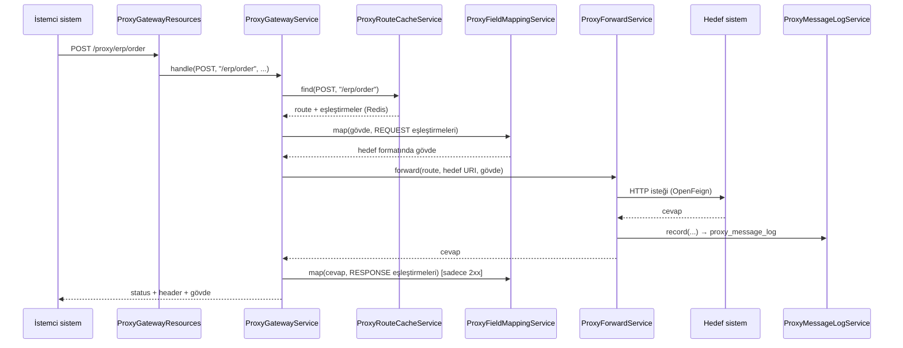

# Message Proxy (TatMetal)

Gelen REST isteklerini, veritabanında tanımlı kurallara göre başka bir sisteme REST ile ileten proxy servis.

- Gelen isteğin **path + HTTP metodu** hangi hedefe gidileceğini (route) belirler.
- Gelen gövdedeki alan isimleri hedef sistemin beklediği isimlere **eşleştirilir** (mapping). Gerekirse hedefin cevabı da geri dönerken eşleştirilir.
- Route ve eşleştirme tanımları PostgreSQL'de tutulur. Uygulama açılışta bunları **Redis**'e yükler, isteklerde sadece Redis'ten okur.
- Hedefin cevabı (status, header, gövde) isteği gönderen sisteme aynen döner.
- Her iletim `proxy_message_log` tablosuna kaydedilir.

---

## İçindekiler

1. [Teknoloji](#teknoloji)
2. [Hızlı başlangıç](#hızlı-başlangıç)
3. [Çalışma mantığı](#çalışma-mantığı)
4. [Paket yapısı](#paket-yapısı)
5. [Sınıf referansı](#sınıf-referansı)
6. [Veritabanı tabloları](#veritabanı-tabloları)
7. [Redis önbellek](#redis-önbellek)
8. [Route eşleşme kuralları](#route-eşleşme-kuralları)
9. [Alan eşleştirme (mapping)](#alan-eşleştirme-mapping)
10. [REST API referansı](#rest-api-referansı)
11. [Hata cevapları](#hata-cevapları)
12. [Loglama](#loglama)
13. [Konfigürasyon](#konfigürasyon)
14. [Yeni bir entegrasyon tanımlama (adım adım)](#yeni-bir-entegrasyon-tanımlama-adım-adım)
15. [Geliştirici notları](#geliştirici-notları)
16. [Sorun giderme](#sorun-giderme)

---

## Teknoloji

| Bileşen | Sürüm / Not |
|---|---|
| Java | 17 |
| Spring Boot | 2.6.4 |
| Spring Cloud | 2021.0.1 (OpenFeign + Apache HttpClient 5) |
| Veritabanı | PostgreSQL 13+ (JDBC, kurum içi `mini_jpa` 0.0.341) |
| Önbellek | Redis (`redisson-spring-boot-starter` 3.27.0, `StringRedisTemplate` ile kullanılır) |
| Güvenlik | Kurum içi `exss-service` 0.0.67 |
| Lombok | Kullanılmaz |

Proje parametreleri (standart dokümanına göre):

| Parametre | Değer |
|---|---|
| Kök paket | `tr.com.tatmetal.proxy` |
| Şema | `message_proxy` |
| JdbcTemplate qualifier | `exdbJdbcTemplate` |

---

## Hızlı başlangıç

**Gerekenler:** PostgreSQL 13+, Redis, Maven, kurum içi Maven reposuna erişim (`mini_jpa`, `exss-service`).

```bash
# 1) PostgreSQL ve Redis ayarlarını application.properties içinde kontrol edin
# 2) Uygulamayı başlatın
mvn spring-boot:run
```

Açılışta sırasıyla şunlar olur:

1. `schema.sql` çalışır; şema, tablolar ve yeni kolonlar yoksa oluşturulur.
2. `ProxyRouteCacheService` aktif route ve eşleştirmeleri veritabanından okuyup Redis'e yazar.
3. Uygulama `/proxy/**` altındaki istekleri karşılamaya başlar.

Hızlı deneme için [Yeni bir entegrasyon tanımlama](#yeni-bir-entegrasyon-tanımlama-adım-adım) bölümüne bakın.

---

## Çalışma mantığı



Adım adım:

| # | Adım | Sorumlu sınıf | Hata durumunda |
|---|---|---|---|
| 1 | `/proxy` prefix'i çıkarılır, kalan path bulunur | `ProxyGatewayResources` | — |
| 2 | Path + metot ile route Redis'ten bulunur | `ProxyRouteCacheService` | 404 `ROUTE_NOT_FOUND` |
| 3 | Hedef URL hazırlanır (`{id}` değişkenleri + query string) | `ProxyGatewayService` | 500 `INVALID_TARGET_URL` |
| 4 | REQUEST eşleştirmeleri gövdeye uygulanır | `ProxyFieldMappingService` | 400 `REQUEST_MAPPING_ERROR` |
| 5 | İstek hedefe iletilir | `ProxyForwardService` + `ProxyForwardClient` | 502 / 504 |
| 6 | İletim loglanır | `ProxyMessageLogService` | Log hatası iletimi bozmaz |
| 7 | 2xx JSON cevaba RESPONSE eşleştirmeleri uygulanır | `ProxyFieldMappingService` | 502 `RESPONSE_MAPPING_ERROR` |
| 8 | Cevap çağırana döner | `ProxyGatewayService` | — |

Hedefin 4xx/5xx cevapları hata sayılıp değiştirilmez; status, header ve gövde aynen döner.

---

## Paket yapısı

```
tr.com.tatmetal.proxy
├── MessageProxyApplication          Uygulama giriş noktası
├── api.v1.resources                 REST API katmanı        (*Resources)
├── services                         Service katmanı         (*Service)
├── entity                           Entity katmanı          (*Entity, BaseEntity'den extend)
├── dao                              Dao katmanı             (*DaoImpl)
│   └── sql                          SQL sabitleri           (*Sql)
├── enums                            IEnumNumber enum'ları   (standart dışı ek paket)
├── model                            Redis'te tutulan tanım nesneleri (standart dışı ek paket)
├── exception                        Uygulama exception'ları (standart dışı ek paket)
├── client                           OpenFeign client'ları   (standart dışı ek paket)
└── config                           Spring konfigürasyonları (standart dışı ek paket)
```

Tablo bazlı sınıf isimlendirmesi (ör. `proxy_field_map` tablosu):

| Katman | Sınıf |
|---|---|
| Entity | `ProxyFieldMapEntity` |
| Sql | `ProxyFieldMapSql` |
| Dao | `ProxyFieldMapDaoImpl` |
| Service | `ProxyFieldMapService` |
| Rest Api | `ProxyFieldMapResources` |

---

## Sınıf referansı

### Uygulama

#### `MessageProxyApplication`
Spring Boot giriş noktası.
- `tr.com.tatmetal.proxy` ile birlikte `tr.com.zenergy.mini_jpa` paketini de tarar. Böylece `@ExtendsBaseEntity` aspect'i gibi `mini_jpa` bileşenleri bean olarak yüklenir.
- `@EnableFeignClients` ile `client` paketindeki Feign client'larını etkinleştirir.

---

### `api.v1.resources` — REST API katmanı

#### `ProxyGatewayResources`
Proxy'nin **giriş kapısı**. `${proxy.gateway.prefix}/**` (varsayılan `/proxy/**`) altındaki GET, POST, PUT, PATCH ve DELETE isteklerini karşılar.
- Prefix'i path'ten çıkarır. Örnek: `/proxy/erp/order` → `/erp/order`.
- Header'ları, query string'i, ham gövdeyi (`byte[]`) ve istemci IP'sini toplar. IP için önce `X-Forwarded-For`, yoksa `remoteAddr` kullanılır.
- İşin geri kalanını `ProxyGatewayService.handle(...)`'a devreder.

#### `ProxyRouteResources`
`/api/v1/proxy-route`: route tanımlarının CRUD işlemleri ve Redis önbellek yönetimi. Her kayıt değişikliğinden sonra Redis otomatik yenilenir. Uç noktalar için [REST API referansı](#rest-api-referansı)'na bakın.

#### `ProxyFieldMapResources`
`/api/v1/proxy-field-map`: alan eşleştirme tanımlarının CRUD işlemleri.
- Hatalı alan yolu (örneğin `[]` sayısı tutmuyor) `ProxyMappingException` olarak yakalanır ve **400 `VALIDATION_ERROR`** döner.
- Eksik `proxyRouteId` `IllegalArgumentException` olarak yakalanır, yine 400 döner.

#### `ProxyMessageLogResources`
`/api/v1/proxy-message-log`: iletim loglarını **salt okunur** sorgular. Kayıtları `ProxyForwardService` ve `ProxyGatewayService` yazar.

---

### `services` — Service katmanı

#### `ProxyGatewayService`
Proxy akışının **orkestratörü**. `handle(method, path, queryString, clientIp, headers, body)` şunları yapar:
1. `ProxyRouteCacheService.find` ile route'u bulur. Yoksa 404, Redis/DB okunamazsa 503 döner.
2. `X-Correlation-Id` header'ı yoksa üretir. Bu değer hedefe de, cevapta çağırana da gönderilir.
3. `target_url` içindeki `{değişken}`'leri gelen path'ten doldurur (URL-encode ederek) ve gelen query string'i hedefe ekler.
4. REQUEST eşleştirmelerini uygular. Hata olursa 400 döner ve `MAPPING_ERROR` logu yazar; istek hedefe **gönderilmez**.
5. `ProxyForwardService.forward(...)`'u çağırır. Bağlantı hatasında 502, zaman aşımında 504 döner.
6. Cevap 2xx ise ve RESPONSE eşleştirmesi tanımlıysa cevabı dönüştürür. Hata olursa 502 döner.
7. Cevabı döndürür. Gövde değişmiş olabileceği için `Content-Length` ve hop-by-hop header'lar taşınmaz.

Eşleştirme sadece JSON gövdelere uygulanır: Content-Type `json` içeriyorsa ya da Content-Type yokken gövde `{` veya `[` ile başlıyorsa. Diğer içerikler (XML, form, binary) dokunulmadan iletilir.

#### `ProxyRouteCacheService`
Route + eşleştirme tanımlarının **Redis önbelleğini** yönetir.
- **`loadOnStartup()`**: `ApplicationReadyEvent` ile, yani `schema.sql` çalıştıktan sonra tetiklenir ve `reload()` çağırır. Redis veya DB o an erişilemezse uygulama yine açılır, hata loglanır; tanımlar ilk istekte tekrar yüklenmeye çalışılır.
- **`reload()`**: aktif route'ları ve eşleştirmeleri DB'den okur, `ProxyRouteDefinition` nesnelerine çevirip JSON olarak Redis'e yazar.
  - Veri önce geçici bir anahtara yazılır, sonra `RENAME` ile asıl anahtarın yerine geçer. Böylece okuyan istekler yarım veri görmez.
  - Aynı path + metot için birden fazla aktif route varsa ilki kullanılır ve uyarı loglanır.
- **`find(method, path)`**: route'u Redis'ten bulur. Sıralama için [Route eşleşme kuralları](#route-eşleşme-kuralları)'na bakın. Sonuç `ProxyRouteMatch` olarak döner: route ve path değişkenleri.
- **`ensureLoaded()`**: Redis'te `{prefix}:loaded-at` anahtarı yoksa (Redis yeniden başladı ya da temizlendi) tanımları DB'den otomatik yeniden yükler.
- **`getAll()`**: Redis'teki tüm tanımları döner. İzleme amaçlı kullanılır.
- **`normalizePath(path)`** (static): path'in başına `/` ekler, sonundaki `/`'ı kaldırır. Kayıt sırasında da kullanılır, böylece `erp/order/` ve `/erp/order` aynı route'a gider.

#### `ProxyFieldMappingService`
JSON **alan eşleştirme motoru**. Jackson `JsonNode` üzerinde çalışır.
- **`map(source, fieldMaps, passUnmappedFields)`**: kaynağı eşleştirme listesine göre dönüştürür.
  - Gövde en üstte bir diziyse (`[{...},{...}]`) her elemana ayrı uygulanır.
  - Tüm değerler önce değiştirilmemiş kaynaktan okunur, sonra yazılır. Bu sayede `a→b`, `b→a` gibi takaslar doğru çalışır.
  - `passUnmappedFields = true`: kaynak kopyalanır; eşleştirilen alanlar eski yerinden silinir, yeni yerine yazılır. Silme sonrası boş kalan ara nesneler de temizlenir.
  - `passUnmappedFields = false`: hedef boş başlar, sadece eşleştirilen alanlar yazılır.
  - İç içe hedef yolundaki ara nesneler yoksa oluşturulur.
- **`validate(sourceField, targetField)`** (static): alan yolu söz dizimini kontrol eder. Hem kayıt sırasında (`ProxyFieldMapService`) hem çalışma anında kullanılır.

Söz dizimi için [Alan eşleştirme](#alan-eşleştirme-mapping) bölümüne bakın.

#### `ProxyForwardService`
Eşleştirmesi yapılmış isteği **hedefe iletir** ve iletimi loglar. Tablodan bağımsızdır.
- **`forward(route, target, incomingMethod, requestPath, clientIp, headers, sourceBody, body)`**:
  - Hedef metodu belirler. Route'ta `PASS_THROUGH` ise gelen metot kullanılır.
  - Hop-by-hop header'ları (`Host`, `Content-Length`, `Connection`, ...) hedefe iletmez.
  - Route bazlı connect/read timeout'ları `Request.Options` ile çağrı anında uygular.
  - Hedef 4xx/5xx dönerse `FeignException`'ı exception olarak bırakmaz, `ResponseEntity`'e çevirir. Böylece cevap çağırana aynen döner.
  - Bağlantı hatası veya timeout'ta (`status <= 0`) log yazar ve exception'ı fırlatır. Gateway bunu 502 ya da 504'e çevirir.
  - Retry yoktur; idempotent olmayan çağrılar (POST vb.) çift gitmez.
- `CORRELATION_ID_HEADER = "X-Correlation-Id"` sabiti diğer sınıflarca da kullanılır.

#### `ProxyMessageLogService`
`proxy_message_log` tablosuna **iletim kaydı** yazar.
- **`record(...)`**: normal iletim kaydı. `result_type` HTTP status'tan hesaplanır.
- **`recordMappingError(...)`**: eşleştirme hatası kaydı (`result_type = MAPPING_ERROR`).
- `Authorization`, `Proxy-Authorization`, `Cookie`, `Set-Cookie` ve `X-Api-Key` header değerleri `******` olarak maskelenir.
- Gövdeler sadece `proxy_route.log_body = 1` ise yazılır ve `proxy.log.max-body-length` karakterde kesilir.
- Log yazımındaki hata **asla iletimi bozmaz**; sadece uygulama loguna düşer.
- Standart `save`, `getOne` ve `getByCondition` metotları da bulunur.

#### `ProxyRouteService`
`proxy_route` için CRUD.
- Kayıt öncesi `source_path`'i normalize eder.
- Her değişiklikten sonra `ProxyRouteCacheService.reload()` çağırır. Redis hatası kaydı geri almaz, sadece loglanır.

#### `ProxyFieldMapService`
`proxy_field_map` için CRUD.
- Kayıt öncesi `proxyRouteId` zorunluluğunu ve alan yolu söz dizimini doğrular, alan yollarındaki boşlukları kırpar.
- Her değişiklikten sonra Redis'i yeniler.

---

### `client` — OpenFeign

#### `ProxyForwardClient`
Dinamik hedeflere istek atan **genel Feign client**.
- Her metotta bir `URI` parametresi vardır. Bu parametre client'ın varsayılan url'ini (`proxy.forward.default-url`) çağrı bazında ezer, böylece tek client ile her hedefe gidilir.
- `Request.Options` parametresi timeout'u çağrı bazında belirler.
- Gövde `byte[]` olarak taşınır; içerik dönüştürülmez.
- Metotlar: `get`, `post`, `put`, `patch`, `delete`. PATCH desteği Apache HttpClient 5 (`feign-hc5`) ile gelir.

Sabit adresli başka bir sisteme çağrı gerekirse bu paketa ayrı bir `@FeignClient(name = "...", url = "${...}")` eklenmelidir.

---

### `config` — Konfigürasyon

#### `JdbcConfig`
Veri kaynaklarını ve `mini_jpa` template'lerini tanımlar.

| Bean | Açıklama |
|---|---|
| `exDb` (`@Primary`) | `datasource.exdb.*` ayarlarından oluşan ana DataSource. `schema.sql` bunun üzerinde çalışır. |
| `exdbJdbcTemplate` (`@Primary`) | Dao'ların `@Qualifier("exdbJdbcTemplate")` ile kullandığı `ZenergyNamedJdbcTemplate` |
| `pgDb` | `datasource.pgdb.*` ayarlarından ikinci DataSource |
| `pgJdbcTemplate` | İkinci DataSource için template |

> İkinci DataSource **`@Primary` olmamalıdır.** İki `@Primary` DataSource olursa Spring `schema.sql`'i çalıştırmaz.

#### `ProxyFeignConfig`
Sadece `ProxyForwardClient`'a özel Feign ayarları: Retry kapalı (`Retryer.NEVER_RETRY`) ve log seviyesi `BASIC`.
Bilerek `@Configuration` **değildir**; aksi halde ayarlar tüm Feign client'larına uygulanırdı.

---

### `entity` — Entity katmanı

Tüm entity'ler `mini_jpa` `BaseEntity`'den extend eder. Standart alanlar (`id`, `id_serial`, `etag`, `status`, `date_of_recorded`, ...) oradan gelir.

| Sınıf | Tablo | Açıklama |
|---|---|---|
| `ProxyRouteEntity` | `proxy_route` | Gelen path/metot → hedef tanımı |
| `ProxyFieldMapEntity` | `proxy_field_map` | Route'a bağlı kaynak alan → hedef alan eşleştirmesi |
| `ProxyMessageLogEntity` | `proxy_message_log` | İletim kaydı. `toString()` gövde ve header'ları bilerek yazmaz. |

Kolon detayları için [Veritabanı tabloları](#veritabanı-tabloları) bölümüne bakın.

---

### `dao` ve `dao.sql` — Veri erişim katmanı

Her Dao `@Repository`'dir ve `exdbJdbcTemplate` kullanır. Standart metotlar:

| Metot | Açıklama |
|---|---|
| `save`, `saveAll`, `update` | `@ExtendsBaseEntity` ile standart alanlar otomatik doldurulur |
| `delete` | `mini_jpa` delete; standarda göre kayıt silinmez, `status = 1 (CANCELLED)` yapılır |
| `getOne(id, etag)` | Tek kayıt |
| `getByCondition(params)` | `ParamsToCondition` ile dinamik WHERE. Örnek: `{"routeCode": "ERP_ORDER"}` |

Ek metotlar:

| Sınıf | Metot | SQL sabiti | Açıklama |
|---|---|---|---|
| `ProxyRouteDaoImpl` | `getActiveList()` | `ProxyRouteSql.PROXY_ROUTE_GET_ACTIVE_SQL` | `status = 3` ve `source_path <> '-'` olan route'lar |
| `ProxyFieldMapDaoImpl` | `getActiveList()` | `ProxyFieldMapSql.PROXY_FIELD_MAP_GET_ACTIVE_SQL` | Aktif route'lara ait aktif eşleştirmeler, `field_order` sırasıyla |
| `ProxyMessageLogDaoImpl` | — | — | Sadece standart metotlar |

`getActiveList()` diğer okuma metotlarından farklı olarak hata durumunda `null` dönmez, exception fırlatır. Böylece Redis'e eksik veri yazılmaz.

`*Sql` sınıfları (`ProxyRouteSql`, `ProxyFieldMapSql`, `ProxyMessageLogSql`) sadece `public static final String` SQL sabitleri içerir.

---

### `model` — Redis tanım nesneleri

Redis'te JSON olarak tutulan, entity'den bağımsız sade nesneler. Böylece önbellek içeriği `mini_jpa`/`BaseEntity` yapısından etkilenmez.

| Sınıf | Açıklama |
|---|---|
| `ProxyRouteDefinition` | Bir route'un çalışma anında gereken tüm bilgisi, REQUEST ve RESPONSE eşleştirme listeleriyle birlikte. Metotlar metin olarak tutulur: kaynakta `ANY`/`GET`/`POST`..., hedefte `PASS_THROUGH`/`GET`/... |
| `ProxyFieldMapDefinition` | Tek eşleştirme: `sourceField`, `targetField`, `required`, `defaultValue`, `fieldOrder` |
| `ProxyRouteMatch` | `find` sonucu: bulunan route ve path'ten çıkarılan değişkenler. Örnek: `/erp/order/{id}` + `/erp/order/42` → `{id=42}` |

---

### `enums`

Hepsi `IEnumNumber` uygular ve DB'de `smallint` olarak saklanır. JSON'da hem `id` (`2`) hem isim (`"POST"`) ile gönderilebilirler.

| Enum | Değerler | Kullanıldığı yer |
|---|---|---|
| `HttpMethodEnum` | 0 `PASS_THROUGH`, 1 `GET`, 2 `POST`, 3 `PUT`, 4 `PATCH`, 5 `DELETE` | `proxy_route.source_method` (0 = tüm metotlar), `proxy_route.target_method` (0 = gelen metot) |
| `MapDirectionEnum` | 1 `REQUEST`, 2 `RESPONSE` | `proxy_field_map.map_direction` |
| `YesNoEnum` | 0 `NO`, 1 `YES` (JSON'da `true`/`false` da kabul edilir) | `log_body`, `pass_unmapped_fields`, `is_required` |
| `ProxyResultEnum` | 1 `SUCCESS`, 2 `TARGET_ERROR`, 3 `CONNECTION_ERROR`, 4 `MAPPING_ERROR` | `proxy_message_log.result_type` |

---

### `exception`

| Sınıf | Açıklama |
|---|---|
| `ProxyMappingException` | Eşleştirme yapılamadığında (zorunlu alan yok, dizi beklenen yerde dizi yok, hatalı tanım) fırlatılır. Gateway'de 400/502'ye, field-map API'sinde 400'e çevrilir. |

---

## Veritabanı tabloları

`src/main/resources/schema.sql` uygulama açılışında çalışır ve idempotent'tir: var olan tabloya dokunmaz, eksik kolonları `ALTER TABLE ... ADD COLUMN IF NOT EXISTS` ile ekler.

**Standart (Paketleme Veritabanı ile aynı):**
- Her tabloda `<BASE_COLUMNS>` bulunur: `id`, `id_serial`, `etag`, `status`, `date_of_recorded`, `user_who_recorded`, `date_of_last_updated`, `user_who_last_updated`, `counter_of_unique_data`.
- Anahtarlar:
  - `PRIMARY KEY (id)`
  - `uk0_<tablo> UNIQUE (id_serial)`
  - İş anahtarı: `ukN_<tablo> UNIQUE (<alanlar>, counter_of_unique_data)`
  - Yabancı anahtar: `fkN_<tablo> FOREIGN KEY (...) REFERENCES message_proxy.<tablo>(id)`
- `status` değerleri: 1 CANCELLED, 2 PASSIVE, 3 ACTIVE, 4 CLOSED. Kayıt silinmez; `status = 1` yapılır ve `counter_of_unique_data` `message_proxy.counter_of_unique_data_seq` ile artırılır.

### `proxy_route` — Route tanımları

| Kolon | Tip | Varsayılan | Açıklama |
|---|---|---|---|
| `route_code` | varchar(50) | — | Route kodu (`uk1`) |
| `route_description` | varchar(150) | `-` | Açıklama |
| `source_path` | varchar(500) | `-` | Gelen path (prefix hariç): `/erp/order`, `/erp/order/{id}`. `-` ise route Redis'e yüklenmez. |
| `source_method` | smallint | 0 | 0 tüm metotlar, 1 GET, 2 POST, 3 PUT, 4 PATCH, 5 DELETE |
| `target_url` | varchar(500) | — | Hedef URL. `{değişken}` içerebilir: `http://erp/api/orders/{id}` |
| `target_method` | smallint | 0 | 0 gelen metot, diğerleri `source_method` ile aynı |
| `connect_timeout_ms` | integer | 5000 | Bağlantı timeout'u |
| `read_timeout_ms` | integer | 30000 | Cevap okuma timeout'u |
| `log_body` | smallint | 1 | Gövdeler loglansın mı |
| `pass_unmapped_fields` | smallint | 1 | 1: eşleştirilmeyen alanlar aynen aktarılır, 0: sadece eşleştirilenler gönderilir |

Anahtarlar:
- `uk1_proxy_route (route_code, counter_of_unique_data)`
- `uk2_proxy_route (source_path, source_method, counter_of_unique_data)` (`source_path <> '-'` olanlar için)

### `proxy_field_map` — Alan eşleştirmeleri

| Kolon | Tip | Varsayılan | Açıklama |
|---|---|---|---|
| `proxy_route_id` | uuid | — | `fk1` → `proxy_route.id` |
| `map_direction` | smallint | 1 | 1 REQUEST (giden istek), 2 RESPONSE (dönen cevap) |
| `source_field` | varchar(250) | — | Kaynak alan yolu |
| `target_field` | varchar(250) | — | Hedef alan yolu |
| `is_required` | smallint | 0 | 1 ise alan yoksa (ve default yoksa) hata |
| `default_value` | varchar(500) | null | Alan yoksa yazılacak değer (JSON olarak yorumlanır) |
| `field_order` | integer | 0 | Uygulanma sırası |
| `map_description` | varchar(150) | `-` | Açıklama |

Anahtar: `uk1_proxy_field_map (proxy_route_id, map_direction, target_field, counter_of_unique_data)`. Aynı hedef alana iki eşleştirme yazılamaz.

### `proxy_message_log` — İletim kayıtları

| Kolon | Açıklama |
|---|---|
| `proxy_route_id`, `route_code` | Kullanılan route. Kod, route sonradan değişse de kalsın diye kopyalanır. |
| `correlation_id` | `X-Correlation-Id` değeri |
| `client_ip` | İsteği gönderen IP |
| `request_method`, `request_path` | Hedefe giden metot; gelen path + query |
| `target_url` | Gerçekten çağrılan hedef URL (değişkenler doldurulmuş) |
| `request_headers` | Hedefe giden header'lar (hassaslar maskeli) |
| `source_request_body` | Gelen, **eşleştirme öncesi** gövde |
| `request_body` | Hedefe giden, **eşleştirilmiş** gövde |
| `response_status`, `response_headers`, `response_body` | Hedefin cevabı. Ulaşılamadıysa status 0. |
| `duration_ms` | Hedef çağrısının süresi |
| `result_type` | 1 SUCCESS, 2 TARGET_ERROR, 3 CONNECTION_ERROR, 4 MAPPING_ERROR |
| `error_message` | Hata mesajı (en fazla 2000 karakter) |

İndeksler: `(proxy_route_id, date_of_recorded)`, `(correlation_id)`, `(date_of_recorded)`.

---

## Redis önbellek

Anahtarlar `proxy.cache.key-prefix` (varsayılan `message-proxy`) ile başlar:

| Anahtar | Tip | İçerik |
|---|---|---|
| `message-proxy:routes` | HASH | `"POST /erp/order"` → route JSON (sabit path'ler, O(1) okuma) |
| `message-proxy:route-patterns` | HASH | `"GET /erp/order/{id}"` → route JSON (değişken veya joker içeren path'ler) |
| `message-proxy:loaded-at` | STRING | Son yükleme zamanı (ISO-8601) |

Kaynak metodu 0 (tümü) olan route'larda anahtar metodu `ANY` olur: `"ANY /erp/order"`.

**Önbellek ne zaman yenilenir?**

| Durum | Yenileme |
|---|---|
| Uygulama açılışı | Otomatik (`ApplicationReadyEvent`) |
| `/api/v1/proxy-route` veya `/api/v1/proxy-field-map` ile kayıt ekleme/güncelleme/silme | Otomatik |
| Redis yeniden başladı veya `loaded-at` silindi | İlk istekte otomatik |
| DB'ye SQL ile doğrudan değişiklik | **Elle:** `POST /api/v1/proxy-route/cache/refresh` |

Redis içeriğini görmek için `GET /api/v1/proxy-route/cache` kullanılabilir. Komut satırından:

```bash
redis-cli HKEYS message-proxy:routes
redis-cli HGET  message-proxy:routes "POST /erp/order"
```

---

## Route eşleşme kuralları

Gelen istek için route şu sırayla aranır; ilk bulunan kullanılır:

1. Sabit path + gelen metot (`POST /erp/order`)
2. Sabit path + tüm metotlar (`ANY /erp/order`)
3. Değişkenli path + gelen metot (`GET /erp/order/{id}`)
4. Değişkenli path + tüm metotlar (`ANY /erp/order/{id}`)

Birden fazla değişkenli path eşleşirse daha spesifik olan seçilir (Spring `AntPathMatcher` kuralları). Path'lerde `{değişken}`, `*` ve `**` kullanılabilir.

**Path değişkenleri ve query string:**

| `source_path` | `target_url` | Gelen istek | Hedefe giden |
|---|---|---|---|
| `/erp/order` | `http://erp/api/siparis` | `POST /proxy/erp/order` | `POST http://erp/api/siparis` |
| `/erp/order/{id}` | `http://erp/api/siparis/{id}` | `GET /proxy/erp/order/42?detay=1` | `GET http://erp/api/siparis/42?detay=1` |

Path karşılaştırması büyük/küçük harfe duyarlıdır. Sondaki `/` önemsizdir.

---

## Alan eşleştirme (mapping)

### Söz dizimi

| source_field | target_field | Anlamı |
|---|---|---|
| `customerName` | `musteriAdi` | Üst seviye alanın adı değişir |
| `customerName` | `musteri.ad` | Üst seviye alan iç içe alana taşınır (ara nesne oluşturulur) |
| `customer.tax` | `musteri.vergiNo` | İç içe alandan iç içe alana |
| `items[].code` | `kalemler[].urunKodu` | Dizinin her elemanında alan adı değişir |
| `tags[]` | `etiketler[]` | Dizinin sadece adı değişir, elemanlar aynen kalır |
| `orders[].lines[].c` | `siparisler[].satirlar[].kod` | İç içe diziler |

**Kurallar:**
- Kaynak ve hedef yolda `[]` sayısı eşit olmalıdır.
- `[0]` gibi indeks desteklenmez, sadece `[]` kullanılır.
- Yol `.` ile başlayamaz veya bitemez.
- Aynı dizi için tanımlı tüm alanlar tek dizide toplanır. Örneğin `items[].code` ve `items[].qty` birlikte `kalemler[]` dizisini oluşturur.
- Alan yolları büyük/küçük harfe duyarlıdır.

### `pass_unmapped_fields` etkisi

Gelen gövde:
```json
{ "customerName": "Ali", "note": "acil", "items": [ { "code": "A1", "qty": 2, "color": "red" } ] }
```
Eşleştirmeler: `customerName → musteri.ad`, `items[].code → kalemler[].urunKodu`, `items[].qty → kalemler[].miktar`

| `pass_unmapped_fields = 1` (aktar) | `pass_unmapped_fields = 0` (sadece eşleşenler) |
|---|---|
| `{"note":"acil","musteri":{"ad":"Ali"},"kalemler":[{"color":"red","urunKodu":"A1","miktar":2}]}` | `{"musteri":{"ad":"Ali"},"kalemler":[{"urunKodu":"A1","miktar":2}]}` |

### Zorunlu alan ve varsayılan değer

| Kaynakta alan | `default_value` | `is_required` | Sonuç |
|---|---|---|---|
| Var | — | — | Değer taşınır |
| Yok | dolu | — | Varsayılan değer yazılır |
| Yok | boş | 1 | **REQUEST:** 400, istek hedefe gitmez. **RESPONSE:** 502. |
| Yok | boş | 0 | Alan hedefte oluşturulmaz |

`default_value` JSON olarak yorumlanır:

| Değer | Hedefe yazılan |
|---|---|
| `10` | sayı 10 |
| `true` | boolean |
| `"WEB"` | metin WEB |
| `{}` / `[]` | boş nesne / dizi |
| `WEB` (tırnaksız, geçersiz JSON) | metin WEB |

### Nerede uygulanır, nerede uygulanmaz

- **REQUEST** eşleştirmeleri gelen JSON gövdeye, hedefe gönderilmeden önce uygulanır.
- **RESPONSE** eşleştirmeleri sadece hedefin **2xx** dönen JSON cevabına uygulanır. Hata cevapları aynen döner.
- Gövde boşsa ya da JSON değilse eşleştirme atlanır ve gövde aynen iletilir.
- Header'lar ve query parametreleri eşleştirilmez.

---

## REST API referansı

### Proxy girişi

| Metot | Yol | Açıklama |
|---|---|---|
| GET, POST, PUT, PATCH, DELETE | `/proxy/**` | Route'a göre iletim. Örnek: `POST /proxy/erp/order` |

### `/api/v1/proxy-route`

| Metot | Yol | Gövde | Açıklama |
|---|---|---|---|
| GET | `/{id}/{etag}` | — | Tek route |
| POST | `/search` | `{"routeCode":"ERP_ORDER"}` (opsiyonel) | Koşula göre listeleme |
| POST | `/` | `ProxyRouteEntity` | Ekle (+ Redis yenile) |
| POST | `/all` | `[ProxyRouteEntity]` | Toplu ekle |
| PUT | `/` | `ProxyRouteEntity` | Güncelle |
| DELETE | `/` | `ProxyRouteEntity` | Sil (CANCELLED) |
| POST | `/cache/refresh` | — | Redis'i DB'den yenile → `{"loadedRouteCount": n}` |
| GET | `/cache` | — | Redis'teki tanımlar |

Örnek kayıt:
```json
{
  "routeCode": "ERP_ORDER_CREATE",
  "routeDescription": "Sipariş oluşturma",
  "sourcePath": "/erp/order",
  "sourceMethod": "POST",
  "targetUrl": "http://erp.local/api/siparis",
  "targetMethod": "PASS_THROUGH",
  "connectTimeoutMs": 5000,
  "readTimeoutMs": 30000,
  "logBody": true,
  "passUnmappedFields": false
}
```

### `/api/v1/proxy-field-map`

| Metot | Yol | Gövde | Açıklama |
|---|---|---|---|
| GET | `/{id}/{etag}` | — | Tek eşleştirme |
| POST | `/search` | `{"proxyRouteId":"..."}` | Koşula göre listeleme |
| POST | `/` | `ProxyFieldMapEntity` | Ekle (+ doğrulama + Redis yenile) |
| POST | `/all` | `[ProxyFieldMapEntity]` | Toplu ekle |
| PUT | `/` | `ProxyFieldMapEntity` | Güncelle |
| DELETE | `/` | `ProxyFieldMapEntity` | Sil (CANCELLED) |

Örnek kayıt:
```json
{
  "proxyRouteId": "3f1c2b7e-8a4d-4c9e-9b21-5d6e7f8a9b01",
  "mapDirection": "REQUEST",
  "sourceField": "items[].code",
  "targetField": "kalemler[].urunKodu",
  "isRequired": true,
  "fieldOrder": 2
}
```

### `/api/v1/proxy-message-log` (salt okunur)

| Metot | Yol | Gövde | Açıklama |
|---|---|---|---|
| GET | `/{id}/{etag}` | — | Tek log |
| POST | `/search` | `{"correlationId":"..."}` veya `{"routeCode":"..."}` | Koşula göre listeleme |

---

## Hata cevapları

Proxy'nin **kendi ürettiği** hatalar aşağıdaki formatta döner. Hedef sistemin hataları ise değiştirilmeden döner.

```json
{
  "status": 400,
  "error": "REQUEST_MAPPING_ERROR",
  "message": "Zorunlu alan bulunamadı: items[0].code",
  "path": "/erp/order",
  "correlationId": "5b0c..."
}
```

| Status | `error` | Ne zaman | Log'a yazılır mı |
|---|---|---|---|
| 404 | `ROUTE_NOT_FOUND` | Path + metot için aktif route yok | Hayır (uygulama loguna uyarı) |
| 400 | `REQUEST_MAPPING_ERROR` | Zorunlu alan yok / gövde geçersiz JSON / dizi beklenen yerde dizi yok | Evet, `MAPPING_ERROR` |
| 502 | `RESPONSE_MAPPING_ERROR` | Hedefin 2xx cevabı eşleştirilemedi | Evet, `MAPPING_ERROR` |
| 502 | `TARGET_UNREACHABLE` | Hedefe bağlanılamadı | Evet, `CONNECTION_ERROR` |
| 504 | `TARGET_TIMEOUT` | Hedef zamanında cevap vermedi | Evet, `CONNECTION_ERROR` |
| 503 | `ROUTE_CACHE_UNAVAILABLE` | Redis ve DB'den tanım okunamadı | Hayır |
| 500 | `INVALID_TARGET_URL` | `target_url` geçerli bir URI değil | Hayır |
| 400 | `VALIDATION_ERROR` | `/api/v1/proxy-field-map` kaydında hatalı alan yolu | — |

---

## Loglama

- **Correlation ID:** Her isteğin `X-Correlation-Id` değeri olur. İstemci gönderirse o kullanılır, göndermezse üretilir. Bu değer hedefe iletilir, cevapta çağırana döner ve `proxy_message_log.correlation_id`'ye yazılır. Bir isteği uçtan uca izlemek için:
  ```json
  POST /api/v1/proxy-message-log/search
  {"correlationId": "5b0c..."}
  ```
- **Gövdeler:** `log_body = 1` olan route'larda hem gelen hem giden gövde yazılır. Böylece eşleştirmenin ne yaptığı log'dan görülebilir.
- **Maskeleme:** `Authorization`, `Proxy-Authorization`, `Cookie`, `Set-Cookie`, `X-Api-Key`.
- **Uygulama logu:** `logging.level.tr.com.tatmetal.proxy=INFO`. `client` paketi `DEBUG` seviyesindedir, Feign istek satırlarını gösterir.

---

## Konfigürasyon

`src/main/resources/application.properties`:

| Property | Varsayılan | Açıklama |
|---|---|---|
| `server.port` | `${SERVER_PORT:8080}` | HTTP portu |
| `datasource.exdb.*` | — | Ana PostgreSQL bağlantısı (`exDb`) |
| `datasource.pgdb.*` | — | İkinci PostgreSQL bağlantısı (`pgDb`) |
| `spring.sql.init.mode` | `always` | Açılışta `schema.sql` çalışsın |
| `feign.httpclient.hc5.enabled` | `true` | Apache HttpClient 5 (PATCH desteği) |
| `feign.client.config.*` | 5000 / 30000 ms | Varsayılan timeout'lar. Route bazlı değerler bunları ezer. |
| Redis bağlantısı | localhost:6379 | Bkz. [Sorun giderme](#sorun-giderme) — Redis property adları |
| `proxy.gateway.prefix` | `/proxy` | Proxy giriş prefix'i |
| `proxy.cache.key-prefix` | `message-proxy` | Redis anahtar ön eki. Aynı Redis'i paylaşan ortamlarda farklı verin. |
| `proxy.forward.default-url` | `http://localhost` | Feign'in zorunlu taban adresi. Gerçek hedef her çağrıda belirlenir. |
| `proxy.log.max-body-length` | `100000` | Log'a yazılacak gövdenin en fazla karakter sayısı |
| `exss.auth`, `exss.unauth.url` | `true`, `/ns/` | `exss-service` kimlik doğrulama ayarları |

> **Güvenlik:** Veritabanı ve Redis şifrelerini `application.properties`'e açık yazmak yerine ortam değişkeninden okuyun. Örnek: `spring.redis.password=${REDIS_PASSWORD:}`.

---

## Yeni bir entegrasyon tanımlama (adım adım)

Senaryo: İstemci `POST /proxy/erp/order` ile İngilizce alan adlarıyla sipariş gönderiyor; ERP Türkçe alan adları bekliyor ve `siparisNo` dönüyor.

**1. Route ekleyin**
```sql
INSERT INTO message_proxy.proxy_route
       (route_code, route_description, source_path, source_method, target_url, target_method, pass_unmapped_fields)
VALUES ('ERP_ORDER_CREATE', 'Sipariş oluşturma', '/erp/order', 2,
        'http://erp.local/api/siparis', 0, 0)
RETURNING id;
```

**2. Eşleştirmeleri ekleyin** (`<route id>` yerine 1. adımdaki id)
```sql
INSERT INTO message_proxy.proxy_field_map
       (proxy_route_id, map_direction, source_field, target_field, is_required, default_value, field_order) VALUES
('<route id>', 1, 'customerName', 'musteri.ad',          1, NULL,    1),
('<route id>', 1, 'items[].code', 'kalemler[].urunKodu', 1, NULL,    2),
('<route id>', 1, 'items[].qty',  'kalemler[].miktar',   0, '1',     3),
('<route id>', 1, 'channel',      'kanal',               0, '"WEB"', 4),
('<route id>', 2, 'siparisNo',    'orderNo',             0, NULL,    1);
```

**3. Redis'i yenileyin.** SQL ile eklediğiniz için bu adım gerekli; API ile ekleseydiniz otomatik olurdu.
```bash
curl -X POST http://localhost:8080/api/v1/proxy-route/cache/refresh
```

**4. Deneyin**
```bash
curl -i -X POST http://localhost:8080/proxy/erp/order \
  -H 'Content-Type: application/json' \
  -d '{"customerName":"Ali","items":[{"code":"A1","qty":2},{"code":"B2"}]}'
```

ERP'ye giden gövde:
```json
{"musteri":{"ad":"Ali"},"kanal":"WEB","kalemler":[{"urunKodu":"A1","miktar":2},{"urunKodu":"B2","miktar":1}]}
```
ERP `{"siparisNo":"S-1001"}` dönerse istemciye `{"orderNo":"S-1001"}` döner.

**5. Log'u kontrol edin**
```sql
SELECT result_type, response_status, source_request_body, request_body, response_body
FROM message_proxy.proxy_message_log
ORDER BY date_of_recorded DESC LIMIT 5;
```

---

## Geliştirici notları

### Yeni tablo eklerken

1. `schema.sql`'e `CREATE TABLE IF NOT EXISTS` bloğu ekleyin. `<BASE_COLUMNS>`, `uk0` ve `COMMENT` satırlarını unutmayın.
2. Var olan tabloya kolon ekliyorsanız `ALTER TABLE ... ADD COLUMN IF NOT EXISTS` kullanın.
3. Sırasıyla Entity, Sql, DaoImpl, Service ve Resources sınıflarını yazın (isimlendirme tablosuna bakın).

### Route ya da eşleştirmeye yeni alan eklerken

Yeni alan çalışma anında kullanılacaksa sadece entity'ye eklemek yetmez:
1. `ProxyRouteDefinition` / `ProxyFieldMapDefinition`'a ekleyin.
2. `ProxyRouteCacheService.toDefinition(...)` içinde entity'den aktarın.
3. Redis'teki eski JSON'lar bir sonraki `reload()`'da yenilenir.

### Bilinçli tasarım kararları

| Karar | Neden |
|---|---|
| Feign retry kapalı | POST gibi idempotent olmayan çağrılar çift gitmesin |
| Hedefin 4xx/5xx'i exception yapılmaz | Proxy şeffaf olmalı, istemci hedefin hatasını görmeli |
| Log hatası iletimi bozmaz | Log tablosu sorunu iş akışını durdurmamalı |
| Redis'e entity değil `model` nesnesi yazılır | Önbellek `mini_jpa` sürümünden bağımsız kalsın |
| Yükleme geçici anahtar + `RENAME` ile | Yenileme sırasında istekler yarım veri görmesin |
| Redis yoksa açılış durmaz | Redis geç ayağa kalksa da uygulama açılsın, ilk istekte yüklensin |

---

## Sorun giderme

| Belirti | Olası neden / çözüm |
|---|---|
| Her istekte 404 `ROUTE_NOT_FOUND` | `source_path` `-` kalmış olabilir, `status` 3 olmayabilir, metot uyuşmuyor olabilir ya da `/proxy` prefix'i eksik olabilir. `GET /api/v1/proxy-route/cache` ile Redis'te ne olduğuna bakın. SQL ile eklediyseniz `cache/refresh` çağırın. |
| Tablolar oluşmuyor | İki DataSource da `@Primary` olabilir (bkz. `JdbcConfig`); `spring.sql.init.mode=always` olduğunu kontrol edin. |
| Açılışta "Redis'e yüklenemedi" logu | Redis erişilemiyor. Uygulama açılır, Redis gelince ilk istekte yüklenir. |
| Redis `NOAUTH` / bağlantı hatası, şifre tanımlı olduğu halde | **Redis property adları Spring Boot sürümüne bağlıdır.** Spring Boot 2.6'da adlar `spring.redis.host/port/password/username` şeklindedir. `spring.data.redis.*` Spring Boot 3'e aittir ve 2.6'da okunmaz; bu durumda bağlantı varsayılan localhost:6379 ve şifresiz yapılır. |
| Redisson ile açılışta `NoSuchMethodError` / `ClassNotFoundException` (spring-data-redis) | `redisson-spring-boot-starter` 3.27.0 varsayılan olarak Spring Data Redis 3.2 modülünü (`redisson-spring-data-32`) getirir; Spring Boot 2.6 ise Spring Data Redis 2.6 kullanır. Redisson dokümanındaki gibi `redisson-spring-data-32`'yi exclude edip `redisson-spring-data-26` ekleyin veya `spring-boot-starter-data-redis`'e dönün. |
| Gövde değişmeden gidiyor | Content-Type `json` içermiyor olabilir, eşleştirmenin `map_direction`'ı yanlış olabilir ya da cevap 2xx değildir (RESPONSE eşleştirmeleri sadece 2xx'te çalışır). |
| PATCH çalışmıyor | `feign.httpclient.hc5.enabled=true` olmalı (Spring Cloud 2021.0.x'te `spring.cloud.openfeign.*` adları geçersizdir). |
| 504 `TARGET_TIMEOUT` | Route'un `read_timeout_ms` değerini artırın. |
